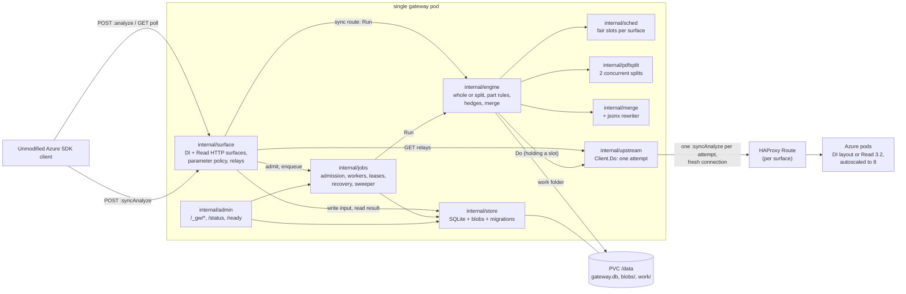
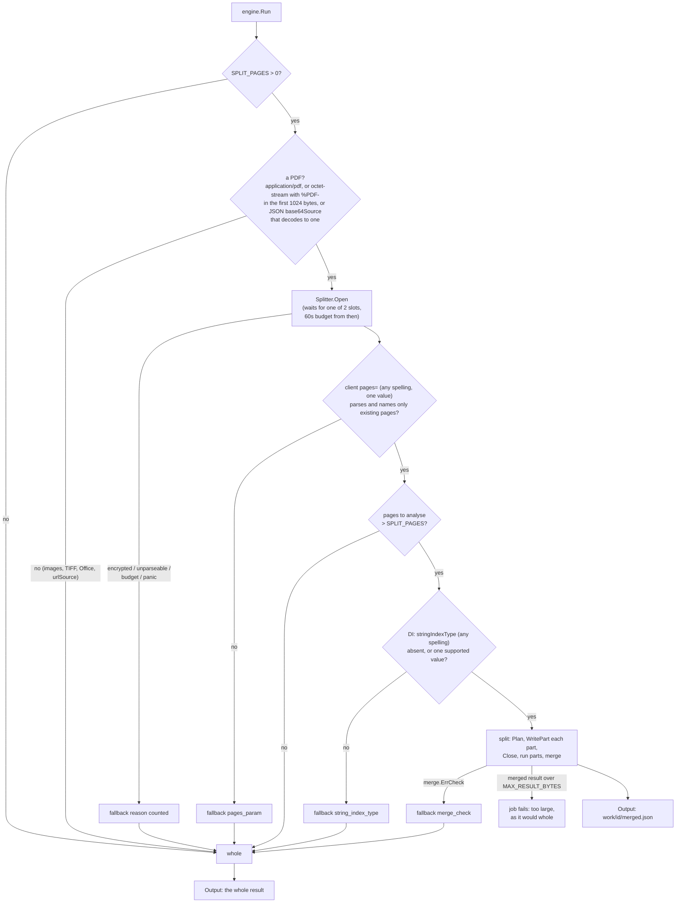
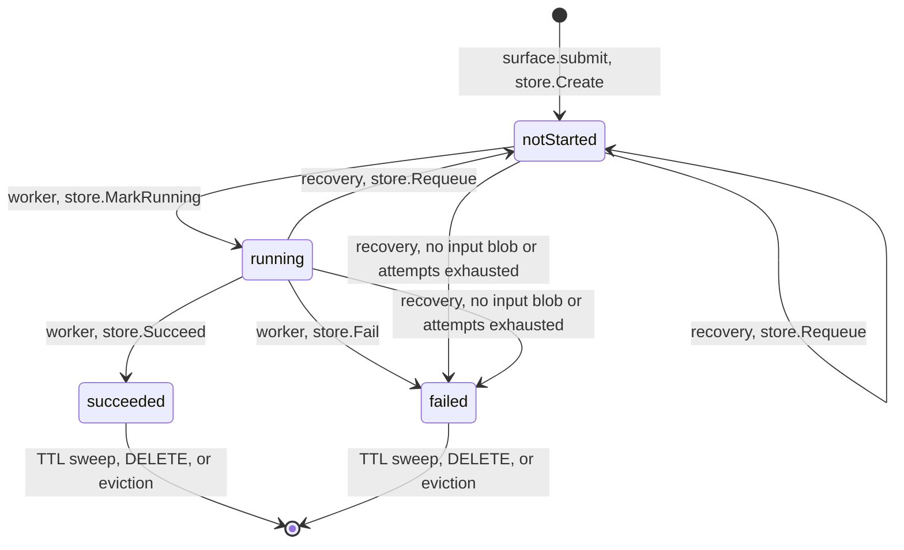
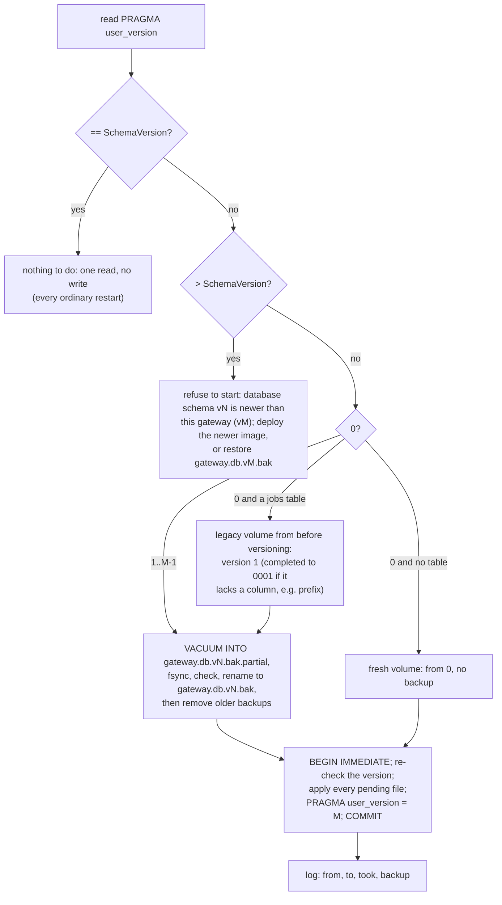

# Gateway architecture

This document explains how `azure-gateway-api` works on the inside, for an engineer who is about
to change it. It covers why the gateway exists, what each package owns, the exact order of
operations on every request path, the upstream attempt model, the splitting engine and its
scheduler, the storage, migration and concurrency models, and a list of invariants a change must
not break. For the client-facing contract see [`docs/api-surface.md`](api-surface.md); for the
designs see the [sync-only upstream design](superpowers/specs/2026-10-10-sync-only-upstream-design.md),
the [large-document splitting design](superpowers/specs/2026-10-10-large-document-splitting-design.md)
and the [original design spec](superpowers/specs/2026-09-08-azure-gateway-api-design.md); for
operator-facing configuration see [`README.md`](../README.md) and [`OPERATIONS.md`](OPERATIONS.md).

> **State of this document.** It describes the sync-only and splitting design as implemented on
> `feat/sync-only-upstream` (plan `docs/superpowers/plans/2026-10-10-sync-only-and-splitting.md`).
> The engine and the switch-over of `jobs` and `surface` to it were finished in parallel with this
> text; where a name below and the code disagree, the code wins and this document is the thing to
> fix.

---

## 1. Why a gateway exists at all

The gateway fronts two on-prem Azure AI containers: Document Intelligence `prebuilt-layout`
(`api-version=2024-11-30`) and Computer Vision Read v3.2 (`model-version=2022-04-30`). Their
*synchronous* behaviour is fine. Their *asynchronous* behaviour is not, and the reason is a
configuration default rather than a bug. In the shipped default configuration the async result
store is container-local: Read v3.x writes results to the container's own `/share` directory and
uses an **in-memory** queue that Microsoft's own documentation labels "Development and testing";
the DI layout container writes to its ephemeral layer unless `SharedRootFolder`/`Mounts:Shared`
are set, with the same in-memory queue. All of this is set out in
[`docs/api-surface.md` §8](api-surface.md#8-multi-replica-failure-mode), which is the reference
for every claim in this section.

Three consequences follow, and they compound. A `resultId` minted by replica A is meaningless to
replica B, so a poll that a load balancer routes elsewhere either 404s or reports `running`
forever — §8.3 records that nobody has pinned down which and lays out both plausible modes, and
§11's open-questions table (row Q-X1) calls the exact status and body of a cross-pod poll
"the single most important unknown in this document". A restart destroys in-flight
work with **no failure signal** and invalidates every operation id already handed to a client. And
`HealthCheck:MemoryUpperboundInMB` defaults to the container's recommended memory, so under memory
pressure the container self-reports unhealthy, the kubelet restarts the pod mid-analysis, and
every stored-but-unretrieved result on that pod is destroyed. §8.4 then explains why a lost poll
is worse than it sounds: a 404 on an in-flight poll raises `HttpResponseError` in Python, marks
the operation **terminally failed** in .NET and JS, and in Java — whose poller never checks the
HTTP status at all — surfaces as an opaque `NullPointerException`.

Microsoft's only supported fix is a shared backing store: `Storage:ObjectStore:AzureBlob:
ConnectionString` plus `Queue:Azure:ConnectionString`, with the flat constraint *"Currently only
Azure Storage and Azure Queue are supported"*. Redis and RabbitMQ were removed in v3.x, so the
install doc's own advice to configure an external cache is stale — setting `Cache:Redis` on a 3.2
container silently does nothing. There is no S3 option and no MinIO option. Outside Azure that fix
simply does not exist, which is exactly the situation §8.2 item 7 describes: *"Air-gapped customers
have no supported shared backend at all."* So the gateway takes ownership of the asynchronous
lifecycle itself. Clients keep the `202 + Operation-Location + poll` contract every Azure SDK is
generated against; the gateway serves those polls from its own durable store on a PVC, and the
call it makes to the containers underneath is always synchronous: one `:syncAnalyze` per attempt,
through the HAProxy Route in front of their pods, retried from the stored input when a pod fails
it.

---

## 2. The shape of the system

One gateway pod, one process, one PVC, in front of up to 8 autoscaled Azure pods per surface that
it reaches **only** through their HAProxy Route. It cannot address, count or discover those pods,
and it uses no Kubernetes API. Operation ids are pod-local by construction, which is precisely why
a PVC is the right store and a second gateway replica is wrong (one replica,
`strategy: Recreate`).



### Packages

`cmd/gateway` sits on top and wires everything; every other row depends only on rows listed
*above* it, with one exception — `httpx` also depends on `ids`, which the table lists later.
`config`, `logging`, `azerr`, `ids`, `jsonx`, `textunit`, `sched`, `pdftest` and `store` have no
gateway-internal dependencies at all.

| Package | Owns | Depends on (internal) |
|---|---|---|
| `cmd/gateway` | wiring, the `serve` / `probe` / `version` subcommands and the probe flags, the migration log line, the two-context lifecycle and the shutdown sequence | everything below |
| `cmd/fakeazure` | paged fakes of both containers on fixed ports, for `scripts/e2e-local.sh`. A development tool; the image builds only `cmd/gateway` | `mockazure` |
| `internal/config` | the 22 settings, fail-fast validation, `Warnings()` (including removed settings), `Redacted()`, the `RetryAfterPoll` / `RetryAfterBusy` constants | — |
| `internal/logging` | `log/slog` JSON or text handler, request-scoped logger in the context | — |
| `internal/httpx` | middleware (`RequestID`, `AccessLog`, `Recover`, `NoCache`, `ServerHeader`), `WriteJSON`, `SetRetryAfter`, `BaseURLResolver` (`PUBLIC_BASE_URL` or `Host`) | `ids`, `logging` |
| `internal/azerr` | both surfaces' error shapes as the containers emit them, the DI/Read code catalogues, `ParseUpstream` | — |
| `internal/ids` | canonical 36-char lowercase v4 GUIDs; `Valid` / `Normalize` | — |
| `internal/jsonx` | byte-range location of a member inside a large JSON document; the streaming, path-aware, byte-preserving rewriter (`Rewrite`, `ArrayItems`) and object helpers (`Members`, `CountItems`) the merge is built on | — |
| `internal/textunit` | `stringIndexType` units and string lengths in each: grapheme clusters (UAX #29, via uniseg), code points, UTF-16 code units | — |
| `internal/sched` | the fair round-robin slot scheduler, one per surface, with `TryAcquireIdle` for hedges | — |
| `internal/store` | the SQLite job store (`db.go`), versioned migrations (`migrate.go`, `migrations/*.sql`), the atomic blob store (`blob.go`), disk usage and network-FS detection (`fs_*.go`) | — |
| `internal/pdftest` | small valid PDFs whose page *i* has MediaBox width `600+i`, so a fake can tell which original pages a part holds | — |
| `internal/pdfsplit` | PDF detection, Azure's `pages` grammar, the balanced planner, and the bounded pdfcpu splitter | — |
| `internal/docgen` | deterministic DI and Read results for any page set, numbered as a whole document or as a part; feeds the fakes and the merge round-trip tests | `textunit` |
| `internal/merge` | the DI and Read part merges and their safety checks (`ErrCheck`) | `jsonx`, `textunit` |
| `internal/upstream` | `Client.Do`: one synchronous attempt, classified into an outcome; `Backoff`; health; the small GET relays (`ProxyGET`) | `azerr`, `config`, `jsonx` |
| `internal/engine` | per job: whole or split, the whole-document loop, the part rules (retry, hedge, halve, re-check), the merge, the work folder, the engine metrics | `merge`, `pdfsplit`, `sched`, `textunit`, `upstream`, `azerr` |
| `internal/jobs` | admission, the worker pool (one runner per configured surface), leases and heartbeats, the claim set, crash recovery, the TTL/eviction/orphan/work-folder sweeper | `azerr`, `config`, `engine`, `store`, `upstream` |
| `internal/surface` | the client-facing handlers: submit, poll, delete, the parameter policy (`params.go`), the engine-backed sync route (`sync.go`), the artifact 404s, the GET relays (`passthrough.go`) | `azerr`, `config`, `engine`, `httpx`, `ids`, `jobs`, `logging`, `store`, `upstream` |
| `internal/admin` | `/_gw/{live,ready,health,version,config,jobs,metrics}` plus container-shaped `/status` and `/ready`, over the configured surfaces only | `config`, `engine`, `httpx`, `jobs`, `store`, `upstream` |
| `internal/app` | assembles the served handler, and `NewEngines`, which builds one scheduler, upstream client and engine per configured surface plus the shared splitter. Exists so `cmd/gateway` and `test/conformance` cannot build different gateways — they did once, and the suite could not see the difference | `admin`, `azerr`, `config`, `engine`, `httpx`, `jobs`, `pdfsplit`, `sched`, `store`, `surface`, `upstream` |
| `internal/probe` | `gateway probe`: the readiness verdict, `--record` (golden responses) and `--compare-split` (whole versus split diff) | `config`, `engine`, `upstream`, and through `--compare-split` the splitting packages |
| `internal/mockazure` | in-process fakes of both containers **including their failure modes and HAProxy's**, and the paged fake that answers per page from `docgen` | `docgen`, `pdfsplit`, `pdftest`, `textunit` |

External dependencies: `modernc.org/sqlite` (pure Go), `github.com/pdfcpu/pdfcpu` v0.16.1
(Apache-2.0, pure Go) and `github.com/rivo/uniseg` v0.4.7 (MIT). All three keep the build
`CGO_ENABLED=0`, so the image stays static and distroless.

`internal/surface` is deliberately one package rather than two. The two surfaces differ only in
URL shape and error vocabulary; splitting them would have duplicated the whole lifecycle to
separate about forty lines (original design spec, "Implementation notes").

### Route ownership

Routes are registered **only for configured surfaces**. A gateway with only `DI_UPSTREAM_URL` set
answers every Read route with the bodyless 404 of an unrouted path, exactly as a DI pod would, and
the reverse for a Read-only gateway.

| Prefix | Registered in | Notes |
|---|---|---|
| `/documentintelligence/**` | `internal/surface/di.go` `registerDI` | `POST .../documentModels/{action}` captures `prebuilt-layout:analyze` whole and splits the verb off in `diAction` |
| `/formrecognizer/**` | same handlers, same file | served because a probe found the containers declaring that family; the prefix the caller arrived on is echoed in `Operation-Location`. Every DI route is registered on both families, metadata included |
| `/vision/v3.2/read/**` | `internal/surface/read.go` `registerRead` | `POST analyze`, `POST syncAnalyze`, `GET`/`HEAD analyzeResults/{operationId}` only — **no DELETE**, because the Read contract does not define one |
| `GET /`, `/swagger`, `/swagger/{rest...}`, `/records/usage-logs`, `/records/usage-logs/{month}/{year}` | `internal/surface/passthrough.go` | relayed to the DI container when DI is configured, else to Read. `{month}` and `{year}` must be digits, else the unrouted 404 |
| `/_gw/**`, `/status`, `/ready` | `internal/admin/admin.go` `Register` | `/_gw` can never collide with an Azure route; both containers claim `/status` and `/ready` at their root, so the gateway serves its own rather than picking a winner |
| a routed path, wrong verb | `internal/app` `unrouted` | `405` with an `Allow` header, matching the containers |
| everything else | `internal/app` `unrouted` | bodyless 404, matching both containers' answer to an unrouted path (`azerr.Unrouted`) |

Not served, by design: `:analyzeBatch` and `analyzeBatchResults`, model build/compose/copy,
`documentClassifiers`, and the container-internal `:syncAnalyze/upstreamResult`. They are
Azure-Blob-bound, not applicable to layout, or internal ([`api-surface.md` §0](api-surface.md#0-what-the-gateway-serves)).

**Headers on every Azure route.** `httpx.ServerHeader` sets `Server: Kestrel` on every response
outside `/_gw/`, before the handler runs, so every exit path carries it. `RequestID` still mints a
request id into the context and the logs, but **no `apim-request-id` header** is sent: the
containers are not known to send one. `x-ms-client-request-id` is echoed.

---

## 3. Request lifecycles

### 3.1 Async submit — the durability contract

On DI, `submit` first applies the parameter policy (`checkDIParams`,
[`api-surface.md` §0](api-surface.md#0-what-the-gateway-serves)): a rejected parameter is a 400
`InvalidArgument` before admission, so nothing is stored.

`internal/surface/surface.go` `submit` is shared by both surfaces. The order below is the contract,
not an implementation detail.

```mermaid
sequenceDiagram
    participant C as Client SDK
    participant S as surface.submit
    participant J as jobs.Manager
    participant B as store.BlobStore
    participant D as store (SQLite)

    C->>S: POST :analyze (body streaming)
    S->>S: requireAPIVersion, checkDIParams (DI); 400 before anything is stored
    S->>S: BaseURL.Resolve(r); empty means 500
    S->>J: DiskPressure? then 503 plus Retry-After 5
    S->>J: Admit(surface); ErrBusy means 429 plus Retry-After 5
    S->>S: ids.New(), SetReadDeadline(UPLOAD_TIMEOUT)
    S->>B: WriteFrom(id, KindInput, r.Body, MAX_REQUEST_BYTES)
    B-->>S: temp, fsync, rename, fsync dir
    S->>D: Create(job) with status notStarted (synchronous=FULL)
    D-->>S: COMMIT
    S->>J: Enqueue(surface, id); claim plus queue
    S-->>C: 202, Operation-Location, Retry-After 1, Content-Length: 0
```

Why that order and not another: the 202 *is* the durability promise. The moment a client holds an
operation id, that id has to resolve for its whole TTL across any crash short of losing the
volume. If the 202 were written before the `INSERT` committed, a crash in that window would leave
the client polling an id that never existed — and per §8.4 a 404 on what the client believes is a
live operation is a hard failure in every SDK family, including an opaque `NullPointerException`
in Java. If the row were committed before the input blob was fsynced, recovery would find a job it
cannot re-run. The blob store's write protocol (`store/blob.go` `Writer.Commit`) is
temp file → `Sync` → `Rename` → `syncDir`, so a reader never observes a partial file, and
`syncDir` deliberately propagates every fsync error except the handful filesystems legitimately
reject (`EINVAL`, `ENOTSUP`, `EBADF`, `EISDIR`) — reporting a rename as durable when it might not
survive power loss would undermine the 202 that rests on it.

Two failure branches inside `submit` are worth knowing. `store.ErrLimitExceeded` from the blob
write becomes `azerr.ContentTooLarge`, which is a **400**, not a 413: 413 is unmodelled on both
surfaces and an nginx sidecar produces HTML for it. And if `Enqueue` fails after the row is
committed, the client gets a 429 rather than a lie — the row is valid and the recovery pass will
pick it up.

The response headers are as load-bearing as the body. Exactly `202`; an absolute
`Operation-Location` in this surface's shape, built from `PUBLIC_BASE_URL` or else the request's
`Host`; an integer-seconds `Retry-After` of 1; `Content-Length: 0`;
and no `Location` header, because Python and JS would issue an extra final GET to it and parse
*that* as the analyze result.

### 3.2 Poll — four states

`internal/surface/surface.go` `poll`. `ids.Normalize` runs first, so a malformed id never reaches
the store; the job's `surface` column is checked so a DI id cannot be polled on the Read path.

| State | Condition | Response |
|---|---|---|
| unknown / expired | `ids.Normalize` fails, `store.Get` errors, surface mismatch, or `now > expires_at` | `404` from `azerr.NotFound(surface)`. DI: flat `{"code":"NotFound","message":"Analyze result does not exist."}`. Read: **wrapped** `{"error":{"code":"BadArgument","message":"Operation ID is invalid, expired or the results matching this operationId have been deleted."}}` — only the DI case sets `flat`; every other error keeps its wrapper, as the containers do |
| `notStarted` / `running` | default branch | `200` + `Retry-After: 1` + `{"status":…,"createdDateTime":…,"lastUpdatedDateTime":…}`. No `analyzeResult` member at all — a null one makes .NET's `AnalyzeResult.FromLroResponse` throw |
| `succeeded` | `streamResult` | `200`, `application/json; charset=utf-8`, exact `Content-Length`, the stored envelope copied byte for byte. If the result blob is missing, this degrades to a `200` `failed` envelope rather than a 500 |
| `failed` | `store.StatusFailed` | `200` with `{"status":"failed",…}` and the stored Azure-shaped `error` object when `error_json` parses. **No `Retry-After`** |

A failed analysis being HTTP 200 is not a stylistic choice: it is how both containers behave and it
is the dominant failure mode on both surfaces. Note also what is absent — the succeeded and failed
branches never set `Retry-After`, because the header is a pacing hint for a poll that will be
repeated. `api-surface.md` §10 item 6 puts it on the 202 and on every non-terminal 200 poll, and
nowhere else; a terminal poll is answered once and has nothing to pace.

### 3.3 A client's `:syncAnalyze` — through the engine

`internal/surface/sync.go` `syncAnalyze` serves both surfaces' synchronous routes. It used to be a
single-attempt passthrough; it now runs the same engine as a background job, so a sync client also
gets retries and splitting. The answer is the one 200 the container's own sync route would have
given.

```mermaid
sequenceDiagram
    participant C as Client
    participant S as surface.syncAnalyze
    participant J as jobs.Manager
    participant W as work/sync-id/
    participant E as engine.Run

    C->>S: POST :syncAnalyze (body streaming)
    S->>S: requireAPIVersion, checkDIParams (DI); 400 before anything is stored
    S->>J: Admit(surface); ErrBusy means 429 plus Retry-After 5
    S->>S: SetReadDeadline(UPLOAD_TIMEOUT)
    S->>W: save the body as work/sync-id/input (MAX_REQUEST_BYTES)
    S->>E: Run(ctx, Input{JobID "sync-id", ...})
    E-->>S: Output (bare result or envelope range) or *azerr.APIError
    alt success
        S->>C: 200, application/json; charset=utf-8, exact Content-Length
    else analysis error
        S->>C: the surface's error shape at the container's status
    end
    S->>W: remove the folder, Output.Cleanup
```

- **Nothing is persisted as a job.** The client holds the connection and gets the whole result
  when it returns, so there is no operation id to keep alive, no row, and no recovery: a restart
  drops the call and the client sees a closed connection, exactly as with a real pod.
- **The body shape follows the container.** When the parts (or the whole document) came back as a
  bare `AnalyzeResult`, the client gets that range of the result file verbatim. Otherwise it gets
  `{"status":"succeeded","createdDateTime":…,"lastUpdatedDateTime":…,"analyzeResult":…}` in the
  container's timestamp format, the `analyzeResult` range copied byte for byte.
- **Errors** are written with `apiErr.WriteTo(w, surface)`, which applies the `Retry-After` rules
  (only ever on a retriable status). A context error after the client disconnected writes nothing.
- **It holds an admission slot** for its whole duration, like a job, and each of its Azure calls
  holds a scheduler slot. A client's sync call can therefore never put more than `*_MAX_INFLIGHT`
  calls on the Azure pods, however many such calls arrive.
- **The client's own timeout matters.** A sync call that is retried or split can legitimately run
  for many minutes, up to the 60-minute job deadline. A route in front of the gateway needs a
  timeout to match (OPERATIONS §3).

The remaining GET relays (`{fam}/info`, `/documentModels`, `/documentModels/{id}`,
`{fam}/operations`, `/operations/{id}`, and the container-root routes) go through
`upstream.Client.ProxyGET` under the metadata lane (4 slots, 10-second timeout) and `relaySync`.
`relaySync` streams any 2xx through with the container's own headers, minus hop-by-hop headers,
`Operation-Location`, `Location` and `Set-Cookie` (`skipRelayHeader`). A non-2xx body is read
(bounded at 64 KB) and then takes one of three branches: a body `azerr.ParseUpstream` recognises is
re-emitted in this surface's shape at the container's own status, with the upstream's
`Retry-After` dropped and re-added only for retriable statuses; a non-empty but unparseable body —
HTML from a sidecar — becomes `azerr.ForStatus` at the container's status, never a synthesised
500; a genuinely empty body is relayed as it arrived, because a probed build answers `/info` and
`/documentModels` with a bodyless 404 and inventing a body there would misrepresent the container.
`ProxyGET` returns the raw `*url.Error` on a transport failure; the caller wraps it with
`transportCause` before anything can reach a client, because a `*url.Error` embeds the whole
upstream URL, userinfo included.

The two artifact routes (`…/analyzeResults/{id}/pdf` and `…/figures/{figureId}`) open no blob. An
unknown or expired id gets `azerr.NotFound(DI)`; a known id gets a 404 `NotFound` /
`OperationNotFound` saying the requested result file was not produced for this operation, because
a sync call never creates the operation those files belong to.

### 3.4 The worker

`internal/jobs/manager.go` `run`, one per queued job, one runner per **configured** surface.

```mermaid
sequenceDiagram
    participant Q as runner.queue
    participant W as manager.run
    participant D as store
    participant E as engine.Run
    participant B as blob store

    Q->>W: job id (already claimed by Enqueue)
    W->>D: Get(id); return if already terminal
    W->>D: MarkRunning(owner, lease now plus 2m, attempts plus 1)
    W->>W: startHeartbeat (Heartbeat every 30s)
    W->>E: Run(ctx, Input from the job row and its KindInput blob)
    E-->>W: Output{Path, Start, End, Bare, Attempts, Parts, ...}
    W->>B: Create(KindResult): prefix, range copy, closing brace
    W->>D: Succeed(resultPath, size, upstreamMs, attempts, parts)
    W->>B: Remove(KindInput); Output.Cleanup removes work/id/
```

The worker no longer waits for an upstream slot itself: every call the engine makes holds a slot
of the surface's scheduler, so the old `AdmitUpstream` 100 ms busy-wait is gone.

`finish` composes **the exact bytes the gateway will later serve**: the literal prefix
`{"status":"succeeded","createdDateTime":"…","lastUpdatedDateTime":"…","analyzeResult":`, then an
`io.Copy` from an `io.SectionReader` over the `analyzeResult` byte range of the engine's output
file — a part result, a whole result or the merged result, which the poll cannot tell apart — then
`}`. A later successful poll is therefore a plain file stream: no re-serialisation, no parse cost,
and no need to hold a result Azure permits to reach 500 MB. The store writes run under
`context.WithoutCancel(ctx)`: the analysis is already done, and losing it to a shutdown signal
would mean paying the pods to redo it.

Error handling in `run` checks **cancellation first, on the context, not on the error**. During
shutdown the engine may already have wrapped the cancellation in a surface-shaped error, and
classifying on the error alone would mark a job terminally failed that recovery could have
resumed — after its 202 was already sent. Otherwise an `*azerr.APIError` from the engine goes to
`failJob`, which stores it as `error_json` together with the attempt and part counts.
`Succeed`/`Fail` both report `RowsAffected`: if the row went away mid-flight (a client `DELETE`, or
disk-pressure eviction) the just-written result is removed rather than left on the volume with
nothing referencing it.

---

## 4. The upstream attempt, the engine and splitting

The old upstream decision tree — try `:syncAnalyze`, latch it off, fall back to `:analyze` and poll
with connection and cookie affinity — is gone, with `DI_SYNC_ANALYZE`, the capability latch, the
affinity client and every poll loop. With autoscaled pods behind HAProxy, an async operation dies
with the pod that owns it, so the gateway now makes **only synchronous calls**, and survives pod
churn by retrying from the input it already holds on the PVC.

### 4.1 One attempt: `upstream.Client.Do`

One attempt is one `POST` of the stored input to the surface's sync route:

- DI: `{prefix}/documentModels/{modelId}:syncAnalyze`, `prefix` being the family the client used;
- Read: `/vision/v3.2/read/syncAnalyze`.

The query is the client's, already policy-checked (§3.1, [`api-surface.md` §0](api-surface.md#0-what-the-gateway-serves)).
`Content-Type` and `Content-Length` come from the body, which is re-opened for every attempt. The
API key header is set when configured; the client's own key is never forwarded.

**A new connection per attempt**: a fresh transport with keep-alive off and no cookie jar. HAProxy
therefore balances every attempt on its own, and a retry is free to land on a different pod — the
opposite of the old affinity client, which existed to pin follow-up polls to one replica.

Each attempt runs under **its own deadline**, `context.WithTimeout(ctx, call.Timeout)`, separate
from the job's context and from the 10-second dial timeout. The response body streams to a temp
file bounded by `MAX_RESULT_BYTES`, and `inspectOperation` finds the byte ranges of `status` and
`analyzeResult` in it, accepting both shapes the sync routes may return: an operation envelope or a
bare `AnalyzeResult`. A success is a `Result{Path, Start, End, Bare, UpstreamMS}` on disk.

**Outcomes** (sync-only design §1). Checked in this order; the first match wins.

| # | Condition | `Outcome` | `Reason` label |
|---|---|---|---|
| 1 | the caller's context ended (shutdown, job deadline) | `Cancelled` — `Err` is nil; the engine returns `ctx.Err()` | — |
| 2 | 200 whose body has an `analyzeResult` (or is a bare result) | `Success` | — |
| 3 | 200 whose `status` is `failed`, any case | `AnalysisFailed` | — |
| 4 | 404, 405 or 501 whose body is not a parseable Azure error, or a 500 matching `looksLikeMissingEndpoint` | `RouteMissing`: *"The <name> container does not serve the synchronous analyze route."* | — |
| 5 | the attempt's own deadline expired, or a 500 or 504 | `RetryOnce` | `timeout`, `status_500`, `status_504` |
| 6 | dial error, connection refused or reset, EOF, TLS failure, body cut short | `Retry` | `connection` |
| 7 | 408, 429, 502, 503 | `Retry` | `status_<code>` |
| 8 | 202 (the container degraded under memory pressure) | `Retry`: the body is drained and the container's operation abandoned, **never polled** | `degraded_202` |
| 9 | any other 4xx, e.g. a 404 carrying `ModelNotFound` | `Terminal`: the container's error relayed in the surface's shape | — |
| 10 | anything else: a 200 with neither `analyzeResult` nor `failed`, a result over `MAX_RESULT_BYTES` | `Terminal` | — |

Two orderings are load-bearing. Row 1 is decided on **the caller's context**, before anything about
the response is read, because a transport error caused by cancellation also looks like a timeout or
a reset. Row 5 is checked before row 6, so a slow analysis whose deadline expired is not mistaken
for a broken connection. HAProxy answers 503 when the Route has no ready pod or a call waited past
its queue time at the per-pod cap; those are row 7 and simply retried.

The 404 ambiguity the old latch fought with survives in row 4 versus row 9: a bodyless Kestrel 404
means the build lacks the route (a deployment fault, so the job fails at once and says so), while a
well-formed DI error naming a model is the client's problem and is relayed.

`Attempt` carries `Status` (0 for transport failures), the parsed integer `RetryAfter`, `Took`, and
`Cause` — the underlying transport error for logs, never shown to a client.

### 4.2 Backoff

Before attempt *n*+1 the engine waits a random duration between 50% and 100% of
`min(60s, 2s × 2^(n−1))` (`upstream.Backoff`). A parseable integer `Retry-After` on the failed
response replaces that wait, capped at 60s. Waiting stops early when the context ends. The jitter
source is injected, so tests are deterministic.

**A job gives its scheduler slot back while it backs off.** Each attempt is `Acquire`, one
`Client.Do`, release; the wait before the next attempt holds no slot, so another job's call can use
it. A deployment answering 503 slows each job down through that job's own backoff and
`Retry-After`, while the gateway keeps up to `MAX_INFLIGHT` calls open. (The sync-only spec §1
asked a job to keep its slot through backoff; the splitting design's per-call scheduler replaced
that rule.)

### 4.3 The engine: whole or split

`engine.Run(ctx, Input)` serves both entry routes — a job from `jobs`, and a client's
`:syncAnalyze` from `surface` — and returns an `Output` on disk or an `*azerr.APIError` (or the
context's error on shutdown). Every job runs under a **60-minute deadline** (`JobDeadline`), the
containers' own maximum task time (`Task:MaxRunningTimeSpanInMinutes`), and gets a work folder
`${DATA_DIR}/work/<jobId>/` (§5).



The containers bind query parameters as ASP.NET does, by name and ignoring case, so the engine
reads `pages` and `stringIndexType` under any spelling (`Pages=`, `StringIndexType=`). A
selection given more than once, under one spelling or several, is the `pages_param` fallback: which
value the container would take is not the gateway's to guess. `stringIndexType` is checked before any
part is cut, because the merge counts offsets in it.

A document that goes whole is sent **exactly as the client sent it**, original body and query,
`pages` included. So a client `pages=` naming pages that do not exist reaches Azure, which answers
with its own error, rather than the gateway inventing one.

**Whole** (`whole.go`): up to **5 attempts** (`WholeAttempts`), of which at most **2** may be the
`RetryOnce` class (a timeout, 500 or 504 — a slow analysis is retried once, not five times). Each
attempt is `Sched.Acquire(ctx, jobID)` → `Client.Do` with `Timeout` = `DI_UPSTREAM_TIMEOUT` or
`READ_SYNC_TIMEOUT` → release, with the backoff of §4.2 between attempts. `AnalysisFailed`,
`Terminal` and `RouteMissing` return at once. When attempts run out, the job fails with the
**last** attempt's error exactly as the container sent it, since the service never reports how often
it was asked. The attempt count goes to the `engine: attempts exhausted` log line and to the job's
`upstreamAttempts` in `/_gw/jobs`, and `gateway_upstream_exhausted_total` counts the job.

### 4.4 Splitting (`internal/pdfsplit`)

- **Parse once, cut many.** `Splitter.Open` reads the PDF into a pdfcpu model once, under
  `model.NewStatelessConfiguration()` with relaxed validation. The stateless configuration is not
  optional: the default one creates `pdfcpu/config.yml` under the user's config directory on first
  use and panics when it cannot, and the gateway runs as non-root on a read-only root filesystem,
  so every split would have fallen back to whole.
- **Planner.** `Plan(pages, SPLIT_PAGES)` cuts the selected pages, in order, into
  `k = ceil(n / SPLIT_PAGES)` consecutive runs, the first `n mod k` one page longer: 6 → 3+3,
  7 → 4+3, 11 → 4+4+3, 21 → 5+4+4+4+4. Every part has between `ceil(SPLIT_PAGES/2)` and
  `SPLIT_PAGES` pages, and records its original page numbers, which need not be consecutive when
  the client's `pages=` skipped some.
- **Cut.** `Document.WritePart` writes each part as a standalone PDF into the work folder
  (`part-<first>-<last>.pdf`, named by its first and last original page). Parts copy
  the original page objects and resources, so each page renders exactly as in the original. Parts
  carry **no named destinations**: pdfcpu patches and prunes the model's `/Dests` tree in place
  while extracting, which gave later parts destinations pointing at pages they do not hold. The
  document is closed as soon as the parts exist, releasing the parsed model and the slot.
- **Limits.** At most **2** documents open at once (a semaphore): parsing is where memory goes,
  since a parsed model holds about 2–3× the file. A **60-second budget** covers opening and every
  cut of one document; it starts once the slot is held, so it bounds the work on this document,
  not the queue in front of it, which the caller's context already bounds. A pdfcpu **panic** is
  recovered as `ErrPanic`, which wraps `ErrUnparseable` — check `ErrPanic` first so the fallback
  reason is `panic`, not `unparseable`.
- **Encryption.** Any encrypted PDF gives `ErrEncrypted`, including one that opens without a
  password (owner-only encryption): sent whole, its encryption is handled by Azure as it always
  was.
- **Failures.** `ErrEncrypted`, `ErrUnparseable`, `ErrPanic` and `ErrBudget` send the document
  whole and count the reason. Any other error from the splitter is an infrastructure failure
  (a full disk, say) and fails as an internal error rather than silently going whole.
- **Halving.** `Splitter.Recut` cuts pages out of an existing part file. The `Document` must be
  closed before any `Recut` from the same `Splitter`, since both need a slot. `WritePart` and
  `Recut` may leave partial output on error, so they always write to temp files.

### 4.5 Part rules

All parts of a job run concurrently; a part that fails the job cancels the rest through a shared
context. Each part attempt is one `:syncAnalyze` with the part PDF as the body
(`application/pdf`) and the client's forwarded parameters **minus `pages`** under every spelling.

| Situation | Rule |
|---|---|
| Attempt timeout | **60 seconds** per part attempt (`PartTimeout`). A 3–5 page part normally takes about 2 s, so a hung pod costs one minute, not fifteen |
| Hedge | an attempt still running after `clamp(4 × median, 5s, 30s)` gets **one** duplicate, if `TryAcquireIdle` succeeds. The median is of the surface's last 200 successful part durations; with fewer than 20 samples the delay is 30s. The first success wins and the other call is cancelled and its file deleted. A hedge belongs to its attempt: the attempt succeeds if either call does, and counts as one failure only if both fail |
| Retriable outcome (rows 5–8) | up to **3 attempts** per part at its current size (`PartAttempts`), with the backoff of §4.2 |
| Still failing after 3 | **halve** the part: the first half is `ceil(n/2)` pages, re-cut from the part's own PDF, and each half gets 3 fresh attempts: 5 → 3+2 → 2+1 / 1+1 → single pages |
| A single page exhausts its attempts | **re-check against the original**, as for a terminal outcome below. The part timeout is far shorter than the whole document's and also covers time queued in HAProxy while pods scale up, so a page that keeps timing out is not yet Azure failing the document. The job fails only if the re-check fails, with the re-check's error |
| Terminal outcome (rows 3, 9, 10) | **re-check against the original**: send the *original* file with `pages=<this part's original pages>` under the whole-document rules (timeout, up to 5 attempts, at most 2 in the `RetryOnce` class), so a transient 503 during a re-check does not fail the job. If that succeeds, its result is used — a splitting artefact can never fail a good document. If it fails terminally too, the job fails with **that** error, Azure's own answer about the original |
| Route not served (row 4) | the job fails at once: a deployment fault |
| Cancelled (row 1) | every part attempt is cancelled; the job stays `running` for recovery |

Every call — part, hedge, re-check or whole — holds a scheduler slot for its duration. Successful
part results are written into the work folder, named by original page range.

### 4.6 The scheduler (`internal/sched`)

One `sched.Scheduler` per configured surface, with `*_MAX_INFLIGHT` slots. A plain semaphore
serves callers in arrival order, and a 2,000-page document puts hundreds of parts in line at once,
so a 2-page job arriving behind them would wait for all of them. Instead:

- **Waiting calls are grouped by job, and jobs take turns: classic round-robin rotation.** The ring
  holds the jobs that have a call waiting, in turn order. `ring[0]` is served next. A job that is
  served and still has calls waiting goes to the **back**; a job whose first call starts waiting
  also joins at the **back**. Every waiting job is therefore served once per round, however many
  calls it has queued and however often other jobs come and go — putting a newcomer anywhere ahead
  of the back would let jobs that keep leaving and returning starve a job with a standing backlog.
  Within a job, calls are served first come, first served. A job running alone still gets every
  slot, because turns go only to jobs that are waiting.
- **A slot changes hands inside one critical section.** A release picks the next waiter and grants
  it the slot under the mutex, so a slot is never free while a call waits for it. A newcomer or a
  hedge cannot take a slot meant for a waiter, and a waiter that gives up finds itself either still
  queued or already granted — in which case it releases what it got.
- **Hedges use idle capacity only.** `TryAcquireIdle` succeeds only when a slot is free *and*
  nobody is waiting, so a hedge never takes a slot a waiting call could have had.
- `Acquire(ctx, job)` returns `(release, err)`; `release` is **nil** when `err` is non-nil, so
  check the error before deferring it. A context that has already ended gets its error even when a
  slot is free. `release` is idempotent.
- `Stats()` is `{InUse, Waiting, Limit}`; it feeds `/_gw/health` `capacity` and the
  `gateway_upstream_slots` metric.

### 4.7 Merge (`internal/merge`, `internal/jsonx`)

The part results are merged in one streaming pass into `work/<id>/merged.json`, written to a temp
file and kept only if the merge succeeds — on an error, `w` may already hold part of the output.
The caller asserts that the parts' planned pages, concatenated, equal the selected pages, and
passes the request's `stringIndexType` as the unit; the parts' results must say the same.

**`jsonx.Rewrite`** is a path-aware tokenizer that copies every byte verbatim and replaces only
targeted scalars, so numbers, string escapes, member order and unknown fields stay exactly as Azure
wrote them, and memory is a few buffers whatever the result size.

**Safety checks.** Any failure is `merge.ErrCheck`, and the engine then analyses the **whole**
document instead (one call, long timeout) and counts `merge_check`:

- `apiVersion`, `modelId`, `stringIndexType` and `contentFormat` are equal across parts, and
  `stringIndexType` equals the request's unit;
- every part has an `analyzeResult`;
- each part's returned pages map to its planned pages — numbered `1..k` (a physically split part,
  mapped through its page list) or already numbered in the original range (a `pages=` re-check,
  mapped to themselves) — and the parts together cover the selected pages exactly once, ascending;
- any top-level member that is not an array is byte-equal across parts (`content` excepted, being
  the text that is merged), and a member is an array in every part or in none;
- every offset, page number and pointer index the merge rewrites is a canonical non-negative
  integer, and every pointer and region falls inside its own part;
- **strict root spans and the per-part unit self-check**: each part's root section spans are
  decoded strictly and must lie within that part's content, and a part with content must have a
  root span. The unit self-check is the end of a part's **page spans**: Document Intelligence gives
  every page a span over its text (a blank page an empty one), so the furthest end of any page's
  span is the service's own measure of the part's content length — in every real output, page
  furniture, blank pages and markdown included — and it must equal the gateway's `textunit.Len`.
  The service and the gateway segment text with different Unicode versions (uniseg implements
  15.0; a .NET runtime may implement 15.1, whose rule GB9c joins Devanagari conjuncts into one
  grapheme cluster), and where they disagree every offset shifted past that part would be wrong —
  so the merge refuses rather than guesses. (Until 2026-10-11 the check compared a root section
  starting at 0 with the content length. Real roots leave out page headers, footers, page numbers
  and blank pages, so most real documents failed it and were analysed whole after every part had
  run.)

**Member order.** The merged `analyzeResult` members are an **order-preserving merge of all the
parts' member orders**. A part's member order is a subsequence of the order the service writes for
the whole document — a part leaves out what it lacks, an empty array for instance — so the merged
order must keep every part's order as a subsequence. Where the parts leave it open, a name first
seen in part *k* goes immediately after its predecessor in part *k*. If a later part orders two
names the other way round, the names are sorted with a **stable topological sort** by every part's
order, taking the earliest name whenever there is a choice. Parts whose orders **contradict** each
other, so that no order keeps them all, are an `ErrCheck`.

**Document Intelligence rules.**

| What | Rule |
|---|---|
| Scalars (`apiVersion`, `modelId`, `stringIndexType`, `contentFormat`) | from the first part |
| `content` | the parts' raw JSON string bodies concatenated, separated by `\n` for `text` (or no `contentFormat`) and `\n<!-- PageBreak -->\n` for `markdown`, escaped in the style part 0 uses. No decode or re-encode |
| every `offset` in a `span` or `spans[]` element, anywhere | `+ shift(part)`: the length of all earlier parts' content plus separators, in the request's unit (`textElements` = extended grapheme clusters per UAX #29 via uniseg; `unicodeCodePoint` = runes; `utf16CodeUnit` = UTF-16 units) |
| `pages[].pageNumber`, and `pageNumber` in every `boundingRegions[]` element | mapped to the original page |
| strings in any `elements` array matching `/(paragraphs\|tables\|figures\|sections\|keyValuePairs)/N` | index plus the earlier parts' element count for that member |
| `figures[].id` (`"<page>.<n>"`) | the page mapped to the original; `<n>` kept |
| `sections` | **one root**, as Azure produces: its `elements` are every part's root elements in order, shifted; its `spans` every root's own spans, shifted, a part's first span joined to the previous part's last **only where nothing but the page separator lies between them** (the earlier root ends where its part does and this one starts where its part does), so the root never covers the page furniture and blank pages the service leaves out of it; other members from the first root that has them. Non-root sections follow in part order, part *k*'s section *i* ≥ 1 becoming `1 + Σ_{j<k}(sections_j − 1 − drop_j) + (i − 1 − drop_k)`. **A section continues across a cut**: a part whose leading content has no heading (its root's first element an untitled leaf section 1, or a root-only part whose first element is not a `title` or `sectionHeading` paragraph) is folded into the deepest last section the earlier parts left open — its elements appended, its spans appended and joined across the separator — and section 1 is dropped (`drop_k = 1`) or the root contributes nothing. A part with no sections is allowed only when it has no content, whichever part it is |
| other arrays (`paragraphs`, `tables`, `figures`, `styles`, `warnings`, unknown arrays) | concatenated in part order with the rules above applied structurally |

**Read rules.** `version` and `modelVersion` must agree and come from the first part;
`readResults[]` are concatenated with `page` mapped to the original. Read results carry no spans or
cross-references, so the Read merge is exact by construction.

**Output.** For a job, the merged `analyzeResult` goes into the gateway's normal envelope. For a
client `:syncAnalyze`, it uses the shape the container's sync route returned for the parts — bare
or wrapped (part 0's `Bare`). The merge writes through a writer capped at `MAX_RESULT_BYTES`
(`Client.MaxResultBytes`) and stops at the ceiling; the job then fails with the same terminal
"result is larger than this gateway accepts" error the document gets sent whole, not through the
`merge_check` fallback. A merged result within the ceiling is moved into the blob store with the
existing atomic write.

**What the merge does not claim.** Everything Azure decides page by page is reproduced exactly.
Document-wide judgements — which heading is `title`, section nesting that continues across a split
point, page header and footer recognition, a table Azure joins across a page break — can differ.
`gateway probe --compare-split` measures them on real documents, and a rule is added only for what
it shows (splitting design §6; OPERATIONS §10).

### 4.8 Engine observability

`engine.Metrics` holds atomic counters and fixed-bucket histograms (buckets 0.25, 0.5, 1, 2, 5,
10, 30, 60, 120 and 300 seconds or parts), rendered by hand on `/_gw/metrics` like the rest:
`gateway_part_seconds`, `gateway_job_parts`, `gateway_merge_seconds`,
`gateway_parts_total{outcome}` (`succeeded`, `retried`, `halved`, `hedged`, `hedge_won`,
`rechecked`), `gateway_split_fallback_total{reason}` (`unparseable`, `encrypted`, `budget`,
`panic`, `pages_param`, `string_index_type`, `merge_check`), `gateway_upstream_retries_total{reason}` and
`gateway_upstream_exhausted_total`. Every engine log line carries `job`, `surface` and, for parts,
`pages` (e.g. `12-15`) and `attempt`; each failed attempt logs one `Warn` line with `attempt`,
`reason`, `status` and `backoffMs`; a job's final line adds `attempts`, `parts`, `halvings`,
`hedges` and `fallback`. A failed run still returns an `Output` with those counts and no result, and
`jobs` records them on the failed row (`upstream_attempts`, `upstream_parts`, `upstream_ms`, and
`upstream_status` from the latest failed call), so a failure says how hard the gateway tried.

---

## 5. State and storage

### The job state machine



Only four status strings ever exist, and they are exactly the strings both Azure surfaces emit
(`store.StatusNotStarted`, `StatusRunning`, `StatusSucceeded`, `StatusFailed`). `canceled` and
`skipped` are never produced: `cancelled` is terminal in JS only, `skipped` in none. A worker whose
context is cancelled by shutdown, or whose engine run is cancelled mid-attempt or mid-backoff,
makes **no** transition — the job stays `running` and is reclaimed on the next boot, because its
202 has already been promised.

### Schema

The schema is whatever the numbered migrations in `internal/store/migrations/` produce. All
timestamps are stored as **unix seconds in `INTEGER` columns** and converted to UTC on scan. At
schema version 2:

```
jobs(id PK, surface, model_id, api_version, status,
     created_at, updated_at, expires_at,            -- INTEGER unix seconds
     request_query, content_type,
     input_path, input_bytes, result_path, result_bytes, error_json,
     attempts, lease_owner, lease_until,
     upstream_status, upstream_ms, client_request_id, prefix,
     upstream_attempts, upstream_parts)             -- added by 0002

INDEX jobs_status  (status, created_at)
INDEX jobs_expiry  (expires_at)
INDEX jobs_surface (surface, status)
```

Two counters are easy to confuse:

- `attempts` counts how many times a **worker** has started the job (`MarkRunning`). Recovery
  fails a job at 3, because a job that keeps killing its worker must not crash-loop the pod.
- `upstream_attempts` counts **calls to Azure** in the job's last run — whole-document attempts, or
  for a split job every part, hedge and re-check attempt — written at completion and shown as
  `upstreamAttempts` on `/_gw/jobs`. `upstream_parts` is the number of parts the job was analysed
  in: **1** means whole, **0** means the job never completed (or completed before migration 0002).

### Versioned migrations

`internal/store/migrate.go`. Before versioning, the schema was one `CREATE TABLE IF NOT EXISTS`,
which does nothing when the table is already there: a changed schema never reached a volume in
service, and dead columns could never be dropped.

- Each file in `migrations/` is `NNNN_name.sql`, numbered from 0001 with no gaps (loading fails at
  startup on a gap or a duplicate). The highest number is the schema version this binary expects
  (`SchemaVersion()`); the version a database is at lives in `PRAGMA user_version`.
- A file holds plain DDL, each statement ending in `;` at the end of a line. Every pending file runs
  in **one** transaction, so a migration must not contain `VACUUM`, and cannot switch
  `foreign_keys` off for a table rebuild (the schema has no foreign keys today).
- **A released file is never edited.** `TestReleasedMigrationsAreUnchanged` pins every file by
  sha256 and fails for a file that is missing from its map, so adding a migration means adding its
  hash. `TestSchemaFromScratchEqualsMigrated` asserts that a fresh volume and a migrated
  version-1 fixture end with the identical `sqlite_master`.

`store.Open` runs `migrate` on the writer connection before the HTTP listener starts:



- **The backup** is taken only when there is data to protect and something to migrate: never for
  a fresh volume, and not for stamping a legacy database as version 1, which touches no row. It is
  written under a `.partial` name and renamed into place only once complete, fsynced and checked,
  because a `VACUUM INTO` cut short is still a valid SQLite file that reads as an *empty* database —
  restored under the backup's name, it would silently drop every job. Only the newest backup is
  kept; older ones go once the new one is in place. A copy an operator saved under another name
  (e.g. `gateway.db.v1-before-upgrade.bak`) is left alone.
- **Failure is atomic.** Any error rolls the transaction back and refuses to start; the database is
  unchanged. A pod killed mid-migration never commits, and the next start tries again.
- **Startup time.** The `jobs` table holds at most `RESULT_TTL` of rows, so a migration takes
  seconds. The startup probe should still allow for it (OPERATIONS §9).
- `Store.Migration` is a `MigrationReport{From, To, Backup, Took, Legacy}`; `cmd/gateway` logs it.

**Migration 0001** is the pre-versioning schema exactly — the version 1 baseline. **Migration
0002** drops the dead columns `upstream_op_url`, `has_pdf`, `figures` and `upstream_mode` (none of
them indexed) with `ALTER TABLE … DROP COLUMN`, and adds `upstream_attempts` and `upstream_parts`,
both `INTEGER NOT NULL DEFAULT 0`. Version-1 rows survive it with the new columns at 0.

**Rollback.** An image that knows migrations refuses a database newer than itself, naming the
backup to restore. An image from **before** versioning does not check `user_version` at all: on a
version-2 database it would start, and every query naming a dropped column would fail. Rolling back
across 0002 therefore always means restoring `gateway.db.v1.bak` first. The procedure is in
OPERATIONS §9.

### PRAGMAs and the single-writer discipline

`store.Open` builds two DSNs against the same `${DATA_DIR}/gateway.db`:

| PRAGMA | Writer | Reader | Why |
|---|---|---|---|
| `journal_mode` | `WAL` | `WAL` | concurrent readers during a write |
| `synchronous` | **`FULL`** | `NORMAL` | the 202 is a durability promise. Both settings survive an application crash; only `FULL` survives node power loss. SQLite's own documentation says WAL with `NORMAL` "might roll back following a power loss or system crash" — which would hand a client an operation id that no longer exists |
| `busy_timeout` | `10000` | `10000` | ms |
| `foreign_keys` | `ON` | `ON` | — |

The writer pool is `SetMaxOpenConns(1)` / `SetMaxIdleConns(1)` / `SetConnMaxLifetime(0)`. SQLite
permits one writer at a time regardless; serialising in the pool converts lock contention into an
orderly queue and makes `synchronous=FULL`'s cost predictable. The read pool is sized
`DI.MaxInflight + Read.MaxInflight + 8` (`cmd/gateway/main.go`), because polls are the hot path and
are read-only.

`Open` also refuses to start when `DATA_DIR` is on a network filesystem — NFS, SMB, CIFS, CephFS,
FUSE, GFS2, OCFS2 by `Statfs` magic on Linux (`fs_linux.go`); nfs/smbfs/afpfs/webdav by
`Fstypename` on Darwin. WAL depends on shared memory and POSIX advisory locks those do not provide
reliably, and silent corruption is a far worse outcome than a clear startup failure.
There is no override: `ALLOW_NETWORK_FS` was removed. On any other platform (`fs_other.go`) `diskUsage` returns an
error, so `DiskUsage` reports `ok=false` and eviction is skipped rather than acting on a wrong
number; `networkFS` there reports a plain "not a network filesystem", so the startup check cannot
fire and the store opens normally.

### Blob layout and the atomic write protocol

```
${DATA_DIR}/blobs/{id[0:2]}/{id[2:4]}/{id}.in        -- the uploaded document (KindInput)
                                     /{id}.res       -- the exact envelope served on a poll (KindResult)
                                     /{id}.pdf       -- legacy: a searchable PDF an older build stored
                                     /{id}.fig-<id>  -- legacy: a cropped figure an older build stored
```

Two-level sharding keeps any one directory small enough that listing stays fast with a day's worth
of results. Every identifier passes through `sanitize()` before it touches a path — gateway ids are
minted GUIDs, but legacy figure ids came from the upstream response, so anything outside
`[A-Za-z0-9_-]` becomes `_` and the result is truncated to 128 bytes.

`Writer.Commit` is the protocol: `os.CreateTemp` in the destination directory → `f.Sync()` →
`f.Close()` → `os.Rename` → `syncDir(dir)`. A reader therefore never sees a partial file, and a
crash mid-write leaves at most a `*.tmp-*` file, which `SweepTemp` removes once it is older than an
hour. `Exists()` exists separately from `Open()` because a presence check that used `Open` and
dropped the `*os.File` leaked a descriptor per orphaned job during restart recovery.

No job creates `KindPDF` or `KindFigure` blobs any more (`output=pdf|figures` is rejected); `RemoveAll`
still deletes the ones older jobs left behind, until their TTL takes them.

### The work folder

`${DATA_DIR}/work/` is the engine's scratch space, on the same PVC as the blobs so a part file is
never copied across filesystems and the sweeper can see it:

```
${DATA_DIR}/work/<jobId>/          one folder per running job
    input.pdf                      a JSON base64Source decoded to a PDF, when there was one
    part-<first>-<last>.pdf        a part, e.g. part-12-15.pdf; halves are re-cut beside it
    result-<first>-<last>.json     each successful part's result, named by original page range
    merged.json                    the merged result
${DATA_DIR}/work/sync-<id>/        a client :syncAnalyze in flight
    input                          its saved body
```

`newWorkdir` empties a folder left by an earlier run of the same job first, since its parts may
come from a different plan. It keeps the job's own input when that lives in the folder, as a
`:syncAnalyze` body does, matched by file identity rather than name; an `:analyze` input lives in
the blob store and is never inside it. Every file is written through `writeFile`, which removes it again on
any error, because a cut or a merge that fails may have written part of its output. A job's folder
is removed when `Run` returns, unless the output lives in it — then
`Output.Cleanup` removes it once `finish` has copied the result into the blob store. Nothing in a
work folder is ever needed after a restart: part progress is deliberately **not** persisted,
because parts take seconds and a restarted job is re-run from its stored input. The sweeper
removes `work/<id>` folders whose job is not running in this process and that are older than an
hour, and `work/sync-*` folders older than an hour, which covers crashes.

### TTL, eviction ordering, and the orphan sweep

`expires_at` is set once at submit to `created_at + RESULT_TTL` (default `24h`, matching the cloud
contract SDK users expect). Enforcement happens in two places: `surface.poll` 404s anything past
`expires_at` immediately, and the sweeper deletes it.

`manager.sweep` runs `sweepOnce` at startup (with `reclaim=false`, because `Recover` covers that
explicitly and doing both would race for the same rows) and then every `GC_INTERVAL` (default `5m`).
One pass does, in order:

1. `store.Expired(now, 512)` → `store.Delete`. The query excludes a `running` job whose lease is
   still live even when expired: deleting it out from under its worker leaves that worker writing a
   result no row references.
2. `Blob.SweepTemp(1h)` — temp files older than an hour cannot belong to a live request.
3. `sweepOrphanBlobs` — walk up to 512 ids in the blob tree, and for any id with no row *and* whose
   blobs are all older than an hour, `RemoveAll`. This is the deliberate counterpart of
   `store.Delete` removing the **row before the blobs**: row-first means the worst case is an
   orphaned blob nobody can observe, whereas blob-first left a row pointing at a result that no
   longer existed, and a poll on that produced the shape that crashes Java clients.
4. The work-folder sweep: `work/<id>` folders whose job is not running in this process, and
   `work/sync-*` folders, once older than an hour.
5. `recover(ctx, false)` on the periodic passes only.
6. `evictUnderPressure`.

Eviction only starts above `DISK_HIGH_WATERMARK` (default `0.90`) and stops the moment usage drops
back below it. `EvictionCandidates` orders `ORDER BY (expires_at >= ?) ASC, updated_at ASC` — that
is, **already-expired results first**, then oldest-updated. Only terminal jobs are eligible.
Dropping a result a client could still legitimately fetch is logged individually at warn level with
its `expiresAt`; ordering by `updated_at` alone used to take those while already-expired rows sat
next to them. Separately, `DiskPressure()` — used by `submit` to refuse cleanly with a 503 — trips
only at `watermark + (1-watermark)/2`, i.e. 0.95 by default, so between the two thresholds the
sweeper is expected to make room without the client noticing.

---

## 6. Concurrency

### The limits

Per configured surface, unless stated otherwise:

| Gate | Capacity | Acquired | Released | Purpose |
|---|---|---|---|---|
| `admits` | `MAX_INFLIGHT + QUEUE_DEPTH` | at admission (`Admit`), non-blocking, by `:analyze` submits **and** client `:syncAnalyze` calls | by the worker in `run`'s defer, by the sync handler on return, or by `submit` on any failure before the 202 is written — `committed` is set only once `Enqueue` succeeds, so the deferred release also covers the post-commit `Enqueue` failure, where the row stays valid and recovery picks it up | bounds accepted-but-unfinished work. With the default `QUEUE_DEPTH=0` a submit is refused the moment every worker is busy |
| `workers` | `MAX_INFLIGHT` goroutines | — | — | how many jobs actually run at once |
| scheduler slots (`sched`) | `MAX_INFLIGHT` | `Acquire` (blocking, fair across jobs) for every call to Azure — whole, part, re-check; `TryAcquireIdle` for a hedge | when that call returns, on every path; never held through backoff | bounds concurrent calls into the Azure pods, however many parts a job fans out into and however many sync clients arrive |
| splitter slots (`pdfsplit`) | **2**, shared by both surfaces | `Splitter.Open` | `Document.Close`, before the parts run | bounds the memory pdfcpu holds while parsing |
| `metadata` | fixed **4** | `AdmitMetadata` in the GET relays | on completion | the read-only relay lane (`/info`, `/documentModels`, `/operations`, the container root). These must not starve analysis nor pile up without bound against a wedged container. Also bounded by a 10-second timeout |

Defaults are `DI_MAX_INFLIGHT=4`, `READ_MAX_INFLIGHT=4`, `QUEUE_DEPTH=0`; production sizing is 16
and a few hundred (OPERATIONS §8). `Admit` never blocks; failure is `ErrBusy`, which becomes
`azerr.TooBusy` — a 429 that **always** carries `Retry-After: 5` (`config.RetryAfterBusy`),
because the JS SDK retries a 429 only when one of the retry-after headers is present. The real pods
never send 429; this is the one deliberate behavioural difference under overload, and every SDK
retries it.

Workers and slots are the same number for a reason: with `MAX_INFLIGHT` jobs running, a single
large job alone can still use every slot, and fairness only has to arbitrate when several jobs
want more than their share.

### The claim set

`Manager.claims` is a mutex-guarded `map[string]struct{}` of ids this process has queued or
running. `Enqueue` and `recoverOne` both go through `claim(id)`, which returns false on a
duplicate. Two independent paths can reach the same row — a live submit and the boot reclaim, or
the boot reclaim and a periodic one — and each duplicate would be a second billed analysis against
the container for a result only one of them stores. Ordering the callers carefully is not enough;
the claim set makes double-enqueue impossible. `unclaim` runs in `run`'s defer.

### Leases and heartbeats

`MarkRunning` writes `lease_owner` (`"<surface>-<n>"`) and `lease_until = now + 2m`
(`leaseDuration`), and increments `attempts`. `startHeartbeat` refreshes the lease every 30 s
(`heartbeatInterval`) under `context.WithoutCancel`, so a layout analysis that legitimately runs for
many minutes is not reclaimed underneath itself. `Requeue` also takes a lease even though no worker
holds the job yet — that lease is what stops the periodic reclaim pass from picking the same row up
again in the window between requeueing it and a worker marking it running.

Recovery reads the store two different ways, and the difference matters:

- **`store.Abandoned`** (boot, `recover(ctx, true)`) ignores leases entirely. A freshly booted
  process holds no leases, so every unfinished row was abandoned by whatever died. Applying the
  lease filter here was a real defect: a crash leaves `lease_until` minutes in the *future*, so the
  boot pass skipped exactly the jobs it existed to rescue and their clients polled `running`
  forever. It also excludes rows past `expires_at`, so an outage longer than the TTL does not
  resubmit every stored job to produce results whose ids already 404.
- **`store.Orphaned`** (periodic, `recover(ctx, false)`) applies the lease filter *and* only
  considers `notStarted` rows created more than `2 × leaseDuration` (4 minutes) ago, so a row a live
  submit is still handing to a worker is never reclaimed.

A recovered job whose input blob is gone, or whose `attempts >= maxAttempts` (3) — worker runs, not
Azure calls — is failed with an
Azure-shaped `InternalServerError` rather than retried forever. Otherwise it **waits** for an
admission slot instead of being refused: a 429 is a refusal to make a promise, and these promises
were already made.

### Shutdown

`cmd/gateway/main.go` runs two separate contexts, and this is the single most important detail in
the file:

```go
signalCtx, stopSignals := signal.NotifyContext(context.Background(), syscall.SIGINT, syscall.SIGTERM)
runCtx, stopRun := context.WithCancel(context.Background())
...
srv := &http.Server{
    BaseContext: func(net.Listener) context.Context { return runCtx },
}
```

`signalCtx` only *triggers* the drain. Request contexts derive from `runCtx`, which outlives the
signal. When they were derived from the signal context, `Shutdown` returned in about 1.5 ms because
every in-flight handler had already been cancelled — an in-flight synchronous call that was
seconds from completing died with a 500, and the grace period existed while nothing used it.

The sequence on SIGTERM, in order:

1. `srv.Shutdown(shutdownCtx)` with `shutdownCtx = context.WithTimeout(Background, SHUTDOWN_GRACE)`
   — stop accepting connections, let in-flight handlers finish. Client `:syncAnalyze` calls are the
   ones that matter: a client is holding the connection waiting for a result.
2. `manager.Drain(shutdownCtx)` — poll `len(r.admits)` every 100 ms until zero or the grace expires,
   giving background jobs whatever time is left.
3. `manager.Stop()` — cancel the worker context and `wg.Wait()`.
4. `stopRun()`.

Anything still running when the grace expires is logged and left `running` in the store, to be
reclaimed on the next start. `Recover` is called explicitly before the listener opens, never
concurrently with live traffic, because a scan racing live submits could pick up a row that had
just committed but not yet been enqueued and run it twice against the container.

The server also deliberately has **no** `ReadTimeout` and **no** `WriteTimeout`: a client may
legitimately spend minutes streaming a 500 MB document, and a client `:syncAnalyze` holds the
connection for the whole analysis, retries and splitting included. `ReadHeaderTimeout` (30 s) still bounds a slowloris on the
headers, `IdleTimeout` is 120 s, and per-request upload duration is bounded by `UPLOAD_TIMEOUT`
(default `10m`) applied through `http.NewResponseController().SetReadDeadline` in
`surface.setUploadDeadline` — the admission slot is necessarily taken before the body is read,
because the body has to be written somewhere, so without that deadline a few trickling connections
take a whole surface offline while it looks perfectly healthy.

---

## 7. Memory

`internal/jsonx` exists for one reason: the gateway must extract the `analyzeResult` member from an
upstream response whose size Azure permits to reach 500 MB, and it must do so without holding that
member in memory.

The obvious implementations both fail. Decoding into a `json.RawMessage` buffers the whole member
per in-flight job. Skipping with `encoding/json`'s `Decoder.Token()` looks streaming but is not:
the tokenizer streams the four structural delimiters and **materialises every other token** — it
grows its internal buffer until an entire scalar fits, then allocates the decoded Go string on top.
The largest member of a Document Intelligence `analyzeResult` is `content`, the extracted text of
the whole document as a single JSON string. The tokenizer-based skip was measured at roughly three
times that string's size in heap — **309 MB peak for a 107 MB `content` string** — and four
concurrent workers on large scans were enough to OOM the pod, after which the boot recovery pass
would re-run them and crash-loop it.

So `jsonx` is a byte scanner. `MemberRange` walks the top-level object with a 64 KB `bufio.Reader`,
tracking absolute offsets; `skipValue` walks composites with a depth counter and counts scalars out
to their terminator, retaining nothing. Only member names are ever accumulated, capped at
`maxNameBytes` (4 KB). One subtlety that was a bug: the value's start offset is found by scanning
whitespace after the colon rather than assuming a fixed lookahead — a fixed 64-byte skip produced
an invalid envelope on a pretty-printed response. The regression test
`TestScanDoesNotMaterialiseLargeScalars` asserts that scanning a ~26 MB string allocates less than a
tenth of its size.

The composition path then keeps the result off the heap end to end:

1. `upstream.Client.Do` streams the upstream response to a temp file inside the blob root, bounded
   by `MAX_RESULT_BYTES` (`io.LimitReader(body, limit+1)`, then reject if `n > limit`), and fsyncs
   it. Nothing is buffered.
2. `inspectOperation` uses `jsonx.ValueRange` to find the byte ranges of `status` and
   `analyzeResult` in that file. Every member read is bounded: `status` at 1 KB (an upstream that
   sent a multi-megabyte status would otherwise be allocated in full), `error` at 64 KB,
   `analyzeResult.errors` at 1 MB, `figures` at 4 MB.
3. `jobs.finish` writes the prefix string, `io.Copy`s an `io.NewSectionReader(src, Start, End-Start)`
   into the blob writer, writes `}`.
4. `surface.streamResult` serves that file with `io.Copy` and an exact `Content-Length`.

`inspectOperation` (`internal/upstream/result.go`) also handles both shapes the synchronous routes
may return: an
operation envelope with a `status`, or a bare `AnalyzeResult` with neither `status` nor
`analyzeResult`, detected by reading the first 64 bytes and asking `jsonx.IsObject`.

---

Splitting adds two memory consumers, and both are bounded by construction:

- **Parsing a PDF.** pdfcpu holds the document's object graph in memory, about 2–3× the file's
  size while parsing. The splitter's two slots are what bound it, whatever the load: two of the
  largest PDFs you accept, at most. The parsed model is released as soon as the parts are written.
- **Merging.** `merge` never materialises a result. It measures each part with byte scanners
  (`jsonx.Members`, `CountItems`), decodes only one part's `content` at a time to count its length
  (a few pages of text), and writes the output with `jsonx.Rewrite` and `ArrayItems`, which hold a
  few buffers whatever the result size. The only values decoded whole are each part's sections,
  pointers and spans for a few pages, one part at a time, and the root and continuation of each.

---

## 8. Invariants

These are the properties a future change must not break. Each names where it is enforced.

**Durability and the poll contract**

1. **The 202 is written only after the input blob is fsynced and the job row is committed.**
   `internal/surface/surface.go` (`submit`), `internal/store/db.go` (`Create`),
   `internal/store/blob.go` (`Writer.Commit`).
2. **The writer connection runs `synchronous=FULL` and `SetMaxOpenConns(1)`.** Anything weaker can
   roll back a committed job on node power loss. `internal/store/db.go` (`Open`, `dsn`).
3. **Every blob write is temp → fsync → rename → fsync-dir, and `syncDir` propagates real errors.**
   `internal/store/blob.go` (`Writer.Commit`, `syncDir`).
4. **A live operation id is never answered with 404.** Only an unknown, wrong-surface, or
   TTL-expired id gets one. `internal/surface/surface.go` (`poll`), `internal/azerr` (`NotFound`).
5. **Every poll response the gateway composes is JSON with a top-level `status`.** A missing result
   blob degrades to a `200` `failed` envelope, never a bare 500. The exception is a panic, whose
   500 carries this surface's error body. `internal/surface/surface.go` (`poll`, `streamResult`).
6. **The status vocabulary is exactly `notStarted | running | succeeded | failed`.**
   `internal/store/db.go`.
7. **A submit returns exactly `202`; a poll of a known, unexpired operation on the right surface
   returns exactly `200`** in every state. `internal/surface/surface.go`.
8. **A merged result is served exactly like a whole one.** The 202, the poll states and the
   envelope do not change with splitting. `internal/jobs/manager.go` (`finish`).

**Headers and addressing**

9. **`Retry-After` is always integer seconds — 1 on the 202 and in-progress polls, 5 on the
   gateway's 429 — and is never attached to a non-retriable status.** `internal/config`
   (`RetryAfterPoll`, `RetryAfterBusy`), `internal/httpx` (`SetRetryAfter`), `internal/azerr`
   (`retriable`, `WriteTo`), `internal/surface/di.go` (`relaySync` drops the upstream value).
10. **No `Location` header on the 202 and no `resourceLocation` in any poll body.**
    `internal/surface/surface.go` (`submit`, `envelope`).
11. **No upstream-minted operation id is ever stored, followed or relayed.** A container's 202 is
    drained and retried, never polled; `Operation-Location` from the container is dropped by every
    relay. `internal/upstream` (classification of row 8), `internal/surface/di.go`
    (`skipRelayHeader`).
12. **The DI `Operation-Location` keeps its exact shape**: absolute, the literal family segment,
    `modelId` four segments from the end and `resultId` two, `?api-version=` present,
    percent-encoded. **The Read one is bare** and ends in a 36-character lowercase GUID.
    `internal/surface/di.go` (`diOperationLocation`), `internal/surface/read.go`
    (`readOperationLocation`), `internal/ids`.
13. **The public base URL is `PUBLIC_BASE_URL`, or else the request's `Host`**, validated as a bare
    authority; forwarded headers are never consulted, and `PUBLIC_BASE_URL` carries no path.
    `internal/httpx` (`BaseURLResolver`, `validAuthority`), `internal/config` (`Load`).
14. **`Server: Kestrel` on every response outside `/_gw/`, and no `apim-request-id` minted by the
    gateway.** `internal/httpx` (`ServerHeader`, `RequestID`).
15. **`x-ms-client-request-id` is echoed.** `internal/httpx` (`RequestID`).

**Inputs and errors**

16. **The parameter policy runs before admission**, so a rejected request leaves no row and no
    blob, on both DI analyze routes. `internal/surface/params.go` (`checkDIParams`).
17. **No upstream path is built from client-controlled input.** Relay targets are rebuilt from
    routed, validated components and re-escaped. `internal/surface` (`validModelID`, the relays).
18. **The client's own API key is never forwarded; the gateway's own key is never logged or
    rendered.** `internal/upstream` (request construction), `internal/config` (`Redacted`).
19. **No upstream error body reaches a client verbatim, the container's status survives, and no
    upstream URL appears in a client-visible message.** `internal/azerr` (`ParseUpstream`,
    `ForStatus`), `internal/upstream` (`transportCause`), `internal/surface/di.go` (`relaySync`).
20. **Errors always use the containers' observed shapes**: DI wrapped except its flat unknown-id
    404, Read wrapped everywhere. There is no other mode. `internal/azerr`.

**Upstream calls**

21. **Every call to Azure — whole, part, hedge, re-check — holds a scheduler slot, and the slot is
    released on every return path.** So the pods never see more than `MAX_INFLIGHT` concurrent
    calls from this gateway. `internal/engine`, `internal/sched`.
22. **Hedges never take a slot a waiting call could use.** `internal/sched` (`TryAcquireIdle`).
23. **Waiting jobs are served in round-robin rotation**, so a small job never waits behind a large
    one's backlog. `internal/sched`.
24. **Cancellation is classified on the context first.** A job interrupted during an attempt or a
    backoff stays `running`, and recovery re-runs it from the stored input; it is never marked
    failed. `internal/upstream` (row 1), `internal/engine`, `internal/jobs/manager.go` (`run`).
25. **Every attempt uses a fresh connection**, so HAProxy balances each one on its own.
    `internal/upstream` (`Client.Do`).
26. **At most 5 attempts per whole document, at most 2 of them of the once-only class; at most 3
    per part size; one hedge per part attempt; a 60-minute deadline per job.** `internal/engine`.
27. **A terminal part failure is re-checked against the original before it can fail a job.**
    `internal/engine` (`parts.go`).

**Splitting and merge**

28. **A merged result is written only when every merge safety check passes**; otherwise the whole
    document is analysed. `internal/merge` (`ErrCheck`), `internal/engine`.
29. **The merge copies everything it does not rewrite byte for byte**, and never decodes and
    re-encodes `content`. `internal/jsonx` (`Rewrite`), `internal/merge`.
30. **Any splitter failure that is a property of the document sends it whole; an infrastructure
    failure fails the job as an internal error.** `internal/pdfsplit`, `internal/engine`.
31. **At most 2 documents are parsed at once, each within a 60-second budget, under pdfcpu's
    stateless configuration, with panics recovered.** `internal/pdfsplit`.
32. **A job's work folder is deleted when the job finishes, and the sweeper removes any that
    outlive their job.** `internal/engine` (`workdir.go`), `internal/jobs/recover.go`.

**Store and lifecycle**

33. **Schema changes reach a volume only through a new, numbered, sha256-pinned migration file,
    applied atomically after a backup; a newer schema is refused.** `internal/store/migrate.go`,
    `TestReleasedMigrationsAreUnchanged`.
34. **No job is enqueued twice.** `internal/jobs` (`claim`, `Enqueue`, `recoverOne`),
    `internal/store/db.go` (`Requeue`).
35. **Boot recovery ignores leases; the periodic pass applies them; neither re-runs a TTL-expired
    job.** `internal/store/db.go` (`Abandoned`, `Orphaned`), `internal/jobs/recover.go`.
36. **The TTL sweep never deletes a `running` job with a live lease, and `Delete` removes the row
    before the blobs.** `internal/store/db.go` (`Expired`, `Delete`).
37. **`Succeed` and `Fail` check `RowsAffected`** and clean up when the row is already gone.
    `internal/store/db.go`, `internal/jobs/manager.go`.
38. **Eviction takes expired results before unexpired ones, and only terminal jobs.**
    `internal/store/db.go` (`EvictionCandidates`), `internal/jobs/recover.go`.
39. **Request contexts do not derive from the signal context.** `cmd/gateway/main.go`
    (`BaseContext`).
40. **An admission slot is bounded in time by `UPLOAD_TIMEOUT`.** `internal/surface`
    (`setUploadDeadline`).
41. **No upstream response is buffered in memory**, and every member read out of one is byte-capped.
    `internal/jsonx`, `internal/upstream` (`result.go`).
42. **The gateway never redirects, never follows one, and never compresses a response.**
    `internal/upstream`, `internal/httpx`.
43. **The gateway refuses to start on a network filesystem, on invalid configuration, or on a newer
    schema** — and reports every configuration problem at once. `internal/store` (`Open`,
    `fs_linux.go`, `migrate.go`), `internal/config` (`Load`).
44. **Identifiers from upstream are sanitised before they become paths.** `internal/store/blob.go`
    (`sanitize`).
45. **Only configured surfaces have routes, runners, schedulers, health entries and metrics.**
    `internal/app` (`NewEngines`), `internal/jobs`, `internal/surface` (`Register`),
    `internal/admin`.

The tests that guard these are listed in [`docs/TESTING.md`](TESTING.md). Four are enforced by code
and review only: 2 (no test references the PRAGMAs or `SetMaxOpenConns`), 40 (nothing exercises
`setUploadDeadline`), 42's compression half (no code path compresses, so there is nothing to
test), and 43's network-FS half on platforms other than Linux and Darwin.

---

## Unverified and worth knowing

- The exact HTTP status and body of a cross-pod poll against an unshared container has never been
  reproduced. It no longer matters to the gateway, which never polls a container, but it is why
  the gateway exists ([`api-surface.md` §8.3](api-surface.md)).
- Whether the DI sync route honours `features`, `queryFields` and `outputContentFormat=markdown`
  is unknown (`api-surface.md` Q-A2); the gateway rejects them until `gateway probe` shows the sync
  and async results are equal.
- The content separators between pages (`\n` for text, `\n<!-- PageBreak -->\n` for markdown) are
  the merge's assumption until `--compare-split` confirms them on real documents; markdown is
  rejected today, so only `\n` is in use.
- `HEAD`, the poll timestamp format and `Retry-After` follow today's behaviour until a recorded
  golden response shows the container doing something else.
- Method mismatches are answered `405` with an `Allow` header by `internal/app`, which asks a
  routes-only mux which verbs the path serves, because the `"/"` catch-all would otherwise turn
  every wrong verb into a bodyless 404.

---

## Related documents

- [`README.md`](../README.md) — what it is, how to configure and run it
- [`docs/OPERATIONS.md`](OPERATIONS.md) — deploying, probing, tuning, and what the logs mean
- [`docs/TESTING.md`](TESTING.md) — the suites, the fakes, and the real-SDK conformance run
- [`docs/CONTAINER-BEHAVIOUR.md`](CONTAINER-BEHAVIOUR.md) — what the real containers actually do
- [`docs/HANDOFF.md`](HANDOFF.md) — state of the work and what is left
- [`docs/api-surface.md`](api-surface.md) — the authoritative contract reference for both
  containers, with evidence grades
- [sync-only upstream design](superpowers/specs/2026-10-10-sync-only-upstream-design.md) and
  [large-document splitting design](superpowers/specs/2026-10-10-large-document-splitting-design.md)
  — the designs this document implements
- [original design spec](superpowers/specs/2026-09-08-azure-gateway-api-design.md) — the first
  design, the 32 confirmed review defects, and what probing real containers changed
