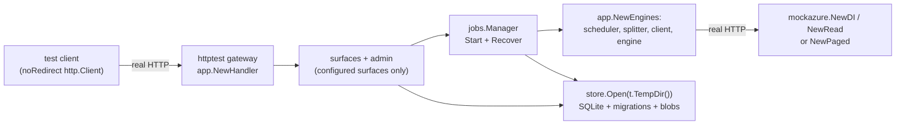

# Testing

This document describes how `azure-gateway-api` is tested and how to verify a change before you
commit it. It is written for someone who has not seen the repository before: it explains what each
layer of the test suite exists for, why the fakes in `internal/mockazure` model failure rather than
success, why most conformance tests exist because a named Azure SDK breaks otherwise, how splitting
is proven page-exact without real containers, and what is deliberately left untested. Companion
documents: [`README.md`](../README.md), [`docs/ARCHITECTURE.md`](ARCHITECTURE.md),
[`docs/OPERATIONS.md`](OPERATIONS.md), [`docs/CONTAINER-BEHAVIOUR.md`](CONTAINER-BEHAVIOUR.md),
[`docs/HANDOFF.md`](HANDOFF.md), [`docs/api-surface.md`](api-surface.md), and the
[sync-only](superpowers/specs/2026-10-10-sync-only-upstream-design.md) and
[splitting](superpowers/specs/2026-10-10-large-document-splitting-design.md) designs, whose §11 and
§10 list the required tests.

---

## 1. The layers

The gateway has to be wire-identical to two Azure containers it cannot reach from a laptop, it has
to survive those containers and their load balancer misbehaving, and its merged results have to
equal what Azure would have produced for the whole document. Those are different problems, tested
at different layers.

| Layer | Where | What it is for |
|---|---|---|
| Unit tests | `internal/<pkg>/*_test.go` | One package at a time: parsing, validation, migrations, the attempt classifier, the scheduler, the splitter, the rewriter, the merge, error rendering. Table-driven. |
| Round-trip tests | `internal/merge/roundtrip_test.go` | A whole-document result from `docgen`, cut into parts, merged back: **byte for byte** equal, for both surfaces and all three `stringIndexType` units. |
| Engine tests | `internal/engine/engine_test.go` | The whole/split decision, retries, hedges, halving, re-checks, fallbacks, fairness and cancellation, against the paged fake with real PDFs. |
| Fakes | `internal/mockazure`, `cmd/fakeazure` | Not tests. HTTP servers that impersonate both containers *including their failure modes and HAProxy's*, and a paged fake that answers per original page. |
| Conformance suite | `test/conformance` | A fully wired gateway — built by the same `app.NewHandler` and `app.NewEngines` as the binary — driven over real HTTP against the fakes. Every endpoint; what unmodified Azure SDK clients depend on. |
| Live end to end | `scripts/e2e-local.sh` | The built gateway binary against `cmd/fakeazure` on real ports: every route by `curl`, the real-SDK suite, and `gateway probe --compare-split`. |
| Real-SDK harness | `test/sdk` | The official Python Azure client libraries pointed at a running gateway, including 23-page PDFs that are split and merged. |

`internal/surface` is tested both through `test/conformance` and with its own handler tests for the
parameter policy, the sync route, the artifact 404s and the relays. Wire shape is still asserted
end to end, because a handler test asserts the shape the handler was written to produce rather
than the shape a client receives.

### How the conformance harness is wired

`newHarness` in [`test/conformance/harness_test.go`](../test/conformance/harness_test.go) builds
the whole system in-process, once per test, on a `t.TempDir()` volume:



Details that carry meaning:

- `noRedirect()` builds every test client with
  `CheckRedirect: func(...) error { return http.ErrUseLastResponse }`, mirroring the .NET
  pipeline, which treats any 3xx as terminal.
- Engines come from `app.NewEngines`, exactly as in `cmd/gateway/main.go`. The two once built
  different gateways and the suite could not see the difference; never build engines by hand in a
  test.
- `harnessOpts` selects the world: `di` / `read` (`mockazure.Options`), `paged` (use
  `mockazure.NewPaged` for both surfaces), `diOnly` / `readOnly` (leave the other upstream unset),
  `splitPages`, and `tweak`, which overrides one `config.Config` field on top of the harness
  baseline.
- The harness config is a hand-written `config.Config` literal, not `config.Load()`, so it inherits
  no defaults. Its values are deliberately test-sized (small `MaxInflight`, 30 s upstream timeouts,
  a 1 h TTL, 16 MiB uploads, a 5 s shutdown grace). It is not a check on the shipped defaults;
  `TestLoadDefaults` in `internal/config` is.

---

## 2. `internal/mockazure` in detail

The package doc states the reason plainly: the failure modes *are* what the gateway exists to
absorb, so "code that is never exercised against those cases is code that has not been tested."
There are two kinds of fake.

### `NewDI(Options)` / `NewRead(Options)` — one container, one behaviour

Each starts an `httptest.Server` with the routes the corresponding container serves. The DI fake
serves a Layout body; the Read fake serves a **real Read v3.2 body** (`version`, `modelVersion`,
`readResults[]` with `lines`, `boundingBox`, `text`, `words`). Both send `Server: Kestrel` unless
`NoServerHeader` is set. Accessors:

| Method | Use |
|---|---|
| `Hits() int64` | How many analyze calls were served. |
| `SyncCalls() int64` | How many synchronous analyze requests were received, failures included. |
| `Requests() []string` | Every path served, in order — e.g. to prove a 202 was never polled. |
| `Called(substr string) bool` | Whether any served path contains `substr`. |

**`SyncBehavior`** — how the synchronous route answers, and the attempt outcome each one produces
(ARCHITECTURE §4.1):

| Value | Fake response | Outcome |
|---|---|---|
| `Sync200` | `200` with a succeeded operation envelope (or a bare result with `SyncBodyBare`) | `Success` |
| `Sync202` | `202` + `Operation-Location` — the container degrading under memory pressure | `Retry` (`degraded_202`); the body is drained and **no poll is made** |
| `Sync404` | bare `404`, no body — a build that does not serve the route | `RouteMissing` |
| `Sync500Unhandled` | `500` `UnhandledEndpointException` — older builds' missing route | `RouteMissing` |
| `SyncModelNotFound` | wrapped `404` with `innererror.code = "ModelNotFound"` | `Terminal`, relayed |
| `SyncHang` | accepts and never answers — a build that declares the route and hangs | the attempt deadline: `RetryOnce` (`timeout`) |

**HAProxy and pod failure modes** — the `Options` fields added for the sync-only design. Each mode
applies to synchronous analyze calls only, and HAProxy's modes answer **before** the API-key check,
because HAProxy answers before any pod sees the request.

| Field | Behaviour | What it models |
|---|---|---|
| `BusyFirst int` | 503 + `Retry-After: 1` for the first *n* calls | every pod at its connection cap, or no ready pod |
| `StatusFirst int`, `StatusFirstCode int` | that status with a container-shaped error for the first *n* calls (502, 504, 500, 408, 429) | gateway errors, timeouts and throttling between HAProxy and the pods |
| `ResetMidBody bool` | writes half the 200 body, then closes the connection | a pod killed mid-response by scale-in |
| `Capacity int` | 503 while more than *k* calls are in flight; 0 = unlimited | `haproxy.router.openshift.io/pod-concurrent-connections` |
| `Latency time.Duration` | delays each synchronous call | real analysis time, and work in flight at shutdown |
| `FailAnalysis`, `FailSyncBare` | `200` with `status: failed` (wrapped error, or Read's bare `{"status":"Failed"}`) | the dominant failure mode on both surfaces: `AnalysisFailed` |
| `PadResultBytes int` | inflates the result | the streaming paths, far beyond any buffer |
| `RequireAPIKey string` | `401` without `Ocp-Apim-Subscription-Key` on analyze routes | the gateway injecting its own credential |
| `MetadataMissing bool` | bodyless 404 on `/info` and `/documentModels` | a probed build; the relay must not invent a body |
| `SyncErrorStatus int` | that status with an **HTML** body and `Retry-After: 120` | an nginx sidecar's error page, unparseable by any SDK |
| `StatusUnhealthy bool` | `/status` reports `apiStatus: Invalid` | a rejected subscription key |

### `NewPaged(PagedOptions)` — the paged fake

The splitting tests need a container that answers correctly for *whatever pages it is sent*. Test
PDFs come from `internal/pdftest`: `pdftest.Make(n)` builds a valid `n`-page PDF whose page *i* has
a MediaBox width of `600+i`. A part carries the original page objects, so the paged fake parses the
body with pdfcpu, maps each page width back to its original page number (`pdftest.PageOf`), and
answers with `docgen`'s result for exactly those pages — without trusting anything the gateway sends
alongside the document.

- **Numbering.** A body whose pages are `1..n` is taken for an original document, with or without
  `pages=`, and answered in original numbering (honouring `pages=` by selecting those pages). A part
  is answered with local numbering `1..k`, as the real container numbers a physically split file.
- **Routes.** `:syncAnalyze` and Read `syncAnalyze`, plus `:analyze` + poll (so the probe's
  sync-versus-async comparisons work), `/status`, `/ready`, `/`, `/swagger` and
  `/swagger/v1/swagger.json`, `/records/usage-logs`, and the DI metadata and `operations` routes.
- **`Calls() [][]int`** returns, for every synchronous analyze served, the original pages it
  covered, in order — so a test can assert exactly which parts, halves, hedges and re-checks were
  sent.

| `PagedOptions` field | Behaviour |
|---|---|
| `Surface` | `DI` or `Read`; DI serves both API families |
| `Doc docgen.Options` | `Unit` (the `stringIndexType` a request naming none is answered in) and `TitleOnFirstPage` (the first analysed page's heading becomes `title` — a document-level judgement, so `--compare-split` has a difference to report) |
| `Hang map[int]bool` | any call covering one of these pages hangs until its client gives up |
| `HangFirst map[int]bool` | only the **first** call covering the page hangs; a retry or a hedge is answered even while the first is still held |
| `FailFirst map[int]int` | page → how many calls covering it answer 503 first. A call fails while any page it covers has failures left, and uses one of each |
| `BadContent map[int]bool` | calls covering the page answer a terminal 400: `InvalidContent` (DI) or `InvalidImageFormat` (Read) |
| `BadOnlyWhenSplit bool` | limits `BadContent` to split parts, modelling a page that fails only when cut out of its document. A part holding the first pages `1..k` is indistinguishable from an original and never bad, so give a later page |
| `Latency`, `APIKey`, `SyncBodyBare`, `Capacity`, `BusyFirst`, `StatusFirst`, `StatusFirstCode`, `ResetMidBody`, `NoServerHeader` | as in `Options` |

### `cmd/fakeazure` — the paged fakes on real ports

```bash
go run ./cmd/fakeazure -di 127.0.0.1:5001 -read 127.0.0.1:5002 -hang 7 -fail-first 3:2 -title-first
```

It serves a paged fake per surface until interrupted, and prints one `NAME=URL` line per fake in
the form the gateway's settings take. The page flags apply to both fakes and accept ranges, bounded
so a typo like `1-1000000` is refused rather than expanded. It is a development tool: the image
builds only `cmd/gateway`.

### The error bodies the fakes emit

`writeUnknownID` reproduces what a probe found the real containers answering for an operation id
they do not know, which is **not** what either published contract says:

```jsonc
// Document Intelligence — flat, its one and only unwrapped error
{"code":"NotFound","message":"Analyze result does not exist."}

// Computer Vision Read — wrapped, and it answers BadArgument because its
// ComputerVisionOcrErrorCodes enum contains no not-found code at all
{"error":{"code":"BadArgument","message":"Operation ID is invalid, expired or the results
 matching this operationId have been deleted."}}
```

A path the fake does not route falls through to `http.ServeMux`'s own `NotFoundHandler`, which —
unlike Kestrel — writes a short `text/plain` body. Kestrel's genuinely bodyless 404 is modelled
explicitly, by `Sync404`; the gateway's own unrouted 404 is bodyless because `azerr.Unrouted` sets
`bare`.

### Driving the shell probe against the fakes

`internal/mockazure/live_test.go` holds both fakes open so
[`scripts/probe-containers.sh`](../scripts/probe-containers.sh) can be exercised without a cluster:

```bash
MOCKAZURE_LIVE=1 go test ./internal/mockazure -run TestLiveMocks &
set -a; . /tmp/mockurls.env; set +a && ./scripts/probe-containers.sh
```

`MOCK_DI_SYNC` selects the DI behaviour by ordinal (the `SyncBehavior` iota order) and
`MOCK_HOLD_SECONDS` how long the fakes stay up, default 120. For the Go probe, `cmd/fakeazure` is
simpler.

---

## 3. The conformance suite

The package comment states the organising principle: *"Each test names the client that breaks if
the assertion fails, because that is the only reason most of these rules exist."*

Almost nothing in this suite is a matter of taste. The gateway's clients are code-generated Azure
SDKs whose pollers make assumptions no published contract records — a hard-coded regex over
`Operation-Location`, a backwards segment count, a `Retry-After` run through an integer
deserialiser. Break one and the failure is remote, opaque and blamed on the wrong component.

### The files

| File | What it covers |
|---|---|
| `endpoints_test.go` | **One table-driven test over every route**: method, path, headers, body, expected status, required and forbidden headers, and a body assertion. DI `:analyze` on both families, poll `GET`/`HEAD` while running and after success, `DELETE`, `:syncAnalyze`, the artifact 404s for known and unknown ids, every relayed GET (`info`, `documentModels`, `operations`, `/`, `swagger`, `records/usage-logs` and its month/year guard), `:analyzeBatch`, an unknown verb, Read `analyze`/`analyzeResults`/`syncAnalyze`, `/ready`, `/status`, every `/_gw/*` endpoint, an unrouted path, a wrong method, a missing `api-version`, unknown result ids on both surfaces, and `x-ms-client-request-id` echo. Every Azure route asserts `Server: Kestrel` and no `apim-request-id`; every `/_gw/*` route asserts no `Server: Kestrel`. |
| `params_test.go` | Each rejected parameter (`output=pdf`, `output=figures`, `outputContentFormat=markdown`, `features=…`, `queryFields`) on `:analyze` and `:syncAnalyze` → 400 `InvalidArgument` naming it, **with no job row and no blob afterwards**; `outputContentFormat=text` and an empty `features` → accepted. |
| `split_test.go` | Against the paged fake with `splitPages 5`: a 40-page PDF through `:analyze` equals the envelope around `docgen.DI(1..40)`; the same through `:syncAnalyze`; Read 40 pages; `pages=10-25`; a page that hangs on its first call (hedge or retry); bad content only when split (re-check, success); an unparseable PDF (whole); `splitPages 0` (one call); 50 submits against `Capacity(4)` with `MaxInflight 16` (all succeed); `/_gw/jobs` showing `upstreamParts`. |
| `single_surface_test.go` | A DI-only gateway serves DI and answers every Read route with the bodyless 404; Read-only the reverse; `/_gw/health` lists one upstream; `/_gw/config` reports the disabled surface's inflight as 0. |
| `parity_test.go` | Replays every golden case under `testdata/golden/<surface>/<tag>/` (an operator's real recording) or `testdata/golden/<tag>/<surface>/` (as `--record` writes one) against a harness whose fakes serve the recorded bodies, comparing status, header names and shapes, and body keys, order and types, under the probe's masks (`<guid>`, `<datetime:…>`, `<base>`). Cases replay in the order `--record` made the analyze round trip, then by name; each sends the body its `request.document` names. `testdata/golden/fake/` holds the set recorded from the paged fake, so the record-and-replay path is always exercised; it carries a profile of what the paged fake does not model (`Cache-Control`, which the gateway adds; the `api-version` in `Operation-Location`; four validation cases), each with its reason. Real recordings are compared in full. |
| `admin_test.go` | The metric families after a split job, with `# HELP`/`# TYPE` and monotonic histogram buckets; health and config shapes. |
| `fidelity_test.go` | Wire-shape rules an SDK depends on — the examples below. |
| `behaviour_test.go`, `sync_test.go` | Lifecycle, retries from the stored input, recovery, admission, TTL. The async-upstream, degraded-202 poll-out and artifact-capture cases were deleted with that code. |
| `method_test.go` | `405` + `Allow` for a routed path with the wrong verb. |
| `legacy_family_test.go` | The `/formrecognizer` family: served, and served identically. |
| `shutdown_test.go` | Durability across a process boundary or a signal. |

### Examples, and the client each one protects

| Test | File | Client it protects, and how it breaks |
|---|---|---|
| `TestDIOperationLocationShape` | `fidelity_test.go` | Python `_patch.py`, .NET `OperationWithId.cs`, Java `PollingUtils` and JS `pollingHelper` all hard-code `[^:]+://[^/]+/documentintelligence/.+/([^?/]+)` to derive the operation id, so the literal `/documentintelligence/` segment must be present. `Azure.AI.FormRecognizer` 4.x counts backwards after `Split('/','?')`, so `analyzeResults` must be second-from-last and `documentModels` fourth-from-last. `?api-version=` must be emitted because Python never re-appends it. |
| `TestDISubmitOmitsLocationHeader` | `fidelity_test.go` | Python's `get_final_get_url` and JS's `operation.ts` issue an extra final `GET` to a `Location` header and parse *that* response as the result. |
| `TestRetryAfterIsIntegerSeconds` | `fidelity_test.go` | The Python DI client runs `Retry-After` through `_deserialize("int", …)`, so an HTTP-date raises. Without the header azure-core falls back to a 30-second polling interval. |
| `TestNoRetryAfterOnNonRetriableErrors` | `fidelity_test.go` | azure-core retries *any* response ≥ 400 that carries `Retry-After`, up to ten times. |
| `TestUnknownIDMatchesTheContainersNotTheSpec` | `fidelity_test.go` | A probe finding: DI answers this one error flat while wrapping everything else; Read wraps it although its own `Ocr.json` models it flat. There is no longer a mode that restores the published shapes. |
| `TestReadOperationLocationIsBare` | `fidelity_test.go` | The Read SDK has no poller; the canonical samples do `split("/")[-1]` and `Substring(len-36)`. |
| `TestSucceededEnvelopeNestsAnalyzeResult` | `fidelity_test.go` | .NET's `AnalyzeResult.FromLroResponse` throws without `analyzeResult`; `resourceLocation` triggers a bogus extra GET in Python, Java and JS. |
| `TestStatusStringsAreExact` | `fidelity_test.go` | Only `notStarted`, `running`, `succeeded`, `failed` are terminal-safe across all four SDK families. |
| `TestPollBodyIsAlwaysJSONWithStatus` | `fidelity_test.go` | Python raises on an empty body, .NET treats it as failure, Java NPEs. |
| `TestNeverRedirects` / `TestNeverCompressesUnlessAsked` | `fidelity_test.go` | .NET sets `AllowAutoRedirect = false` and sends no `Accept-Encoding`. |
| `TestReadBareFailedStatusIsTranslated` | `behaviour_test.go` | Read's bare `{"status":"Failed"}` must become lowercase `failed`. The envelope carries no `error` member, which `ReadOperationResult` does not declare (`TestFailedReadEnvelopeHasNoErrorMember`). |
| `TestLegacyFormRecognizerPrefixIsServed` | `legacy_family_test.go` | `Operation-Location` must echo the family the caller arrived on. |
| `TestPollNeverReturnsABodyWithoutStatus` | `sync_test.go` | A succeeded row whose result blob has gone must answer `200 failed`, never a bare 500 that Java deserialises into an NPE. |
| `TestSignalDoesNotAbortInFlightRequests` | `shutdown_test.go` | SIGTERM must not cancel in-flight handlers; `Shutdown` must actually wait. |
| `TestBootRecoveryReclaimsJobsWithUnexpiredLeases` | `shutdown_test.go` | The boot pass must ignore leases, which a crash leaves minutes in the future. |

Tests assert the job's recorded counts, not only the client-visible result:
`upstreamAttempts` and `upstreamParts` on `/_gw/jobs`, and the fake's `Calls()` or `SyncCalls()`.
A correct answer reached by the wrong route — split when it should have gone whole, or retried
when it should have failed — is a regression, not a success.

### Adding a new fidelity test

1. **Find or write down the reason.** A fidelity rule is only worth a test if you can name what
   breaks: a specific SDK file and expression, or a specific probe observation. If you cannot,
   you are testing a preference, and it belongs somewhere else.
   [`docs/api-surface.md`](api-surface.md) §4, §5, §6 and §10 carry the derivations with citations;
   [`docs/CONTAINER-BEHAVIOUR.md`](CONTAINER-BEHAVIOUR.md) carries the probe observations.

2. **Teach the fake the behaviour, if it does not know it yet.** New container behaviour goes in
   `internal/mockazure` as a new `SyncBehavior` value, an `Options` field or a `PagedOptions` field, with a doc
   comment naming the real-world condition it reproduces. Keep the default zero value equal to the
   healthy case, so existing tests are unaffected.

3. **Add the test to the file that matches its kind.**

   | File | Kind |
   |---|---|
   | `endpoints_test.go` | A new route, or a new header or status rule that applies across routes: add a row. |
   | `fidelity_test.go` | A wire-shape rule an SDK depends on: headers, status codes, body shape, status vocabulary. |
   | `params_test.go` | The parameter policy. |
   | `split_test.go` | Splitting and merging, end to end against the paged fake. |
   | `behaviour_test.go` | Lifecycle: retries from the stored input, TTL, recovery, admission. |
   | `sync_test.go` | Regressions in the synchronous route. |
   | `single_surface_test.go` | A gateway with one upstream. |
   | `shutdown_test.go` | Durability across a process boundary or a signal. |
   | `legacy_family_test.go` | The `/formrecognizer` family: that it is served, and served identically. |

4. **Drive it through the harness, not through a handler.**
   `h := newHarness(t, harnessOpts{di: mockazure.Options{…}, tweak: func(c *config.Config){…}})`,
   then `h.post(...)` / `h.get(...)` / `h.pollUntil(loc, "succeeded")`. Use `harnessOpts.tweak`
   only for the one field the test is about; everything else should stay at the harness baseline
   (§1), so a failure points at your field and not at a second thing you moved.

5. **Write the failure message for the person who did not write the test.** Every assertion in
   this suite says what breaks, not just what mismatched — for example, *"Operation-Location %q has
   a query string; the Python sample's split(\"/\")[-1] then percent-encodes it into the path and
   404s"*. Follow that. Six months from now the message is the only documentation anyone reads.

6. **Prove it fails first.** Every regression test in this suite was written against the defect it
   describes and watched to fail before the fix landed. A green new test is not evidence of
   anything until you have seen it red.

---

## 4. The unit suites

The sync-only and splitting work is mostly new packages, each test-first. What each suite pins:

| Package | Tests | What they pin |
|---|---|---|
| `internal/store` (`migrate_test.go`) | fresh volume reaches the latest version with no backup; a legacy (pre-versioning) database is version 1 and keeps its rows, including one that lost an index or lacks `prefix`; an equal-version start writes nothing (mtime and size unchanged); a newer schema is refused naming the backup; a failing migration leaves the database and `user_version` unchanged; the backup is taken before migrating, only when there is something to migrate, atomically (no `.partial` left as a backup), replacing older ones and sparing an operator's own copies; 0002 keeps v1 rows with the new columns at 0; `TestSchemaFromScratchEqualsMigrated`; `TestReleasedMigrationsAreUnchanged` | the migration contract of ARCHITECTURE §5. The last two guard every **future** migration: the schema from scratch must equal the migrated one, and a released file may never change — its sha256 is pinned, and an unpinned file fails |
| `internal/pdfsplit` | `IsPDF` within 1024 bytes; `ParsePages` accepted and rejected forms; `Select` de-duplication and range; `FormatPages`; `Plan` for 1–2,000 pages, the part-size bounds, non-contiguous selections; `Halve`; a 12-page split re-parsed by MediaBox width; `Recut`; garbage → `ErrUnparseable`; encrypted (user and owner-only) → `ErrEncrypted`; a 1 ns budget → `ErrBudget`; a recovered panic → `ErrPanic`; a third `Open` blocks until a `Close`; a waiting `Open` returns `ctx.Err()` | splitting design §2 |
| `internal/sched` | the limit; round-robin rotation (job A queues three, job B one: A1, B1, A2, A3); FIFO within a job; a cancelled waiter leaves the queue; cancel racing a grant returns the slot (1,000 iterations under `-race`); `TryAcquireIdle` fails while anyone waits; idempotent release; a 50-goroutine stress test that never exceeds the limit | fairness and no slot leaks |
| `internal/textunit` | `abc`, decomposed `é`, a ZWJ family emoji, a flag, `\n`, in all three units | offsets are counted as Azure counts them |
| `internal/jsonx` | `Rewrite` identity over escapes, nested arrays, `-0.0`, `1e-07` and 20-digit integers; targeted replacements change only their bytes; visitor paths; long strings copied unvisited; truncated input and trailing garbage are errors; `ArrayItems`, `Members`, `CountItems`; an allocation bound on a 10 MB input | the merge copies what it does not rewrite byte for byte, in bounded memory |
| `internal/docgen` | valid JSON; spans inside content in the unit; pointers resolve; deterministic bytes | the reference results the fakes and the round trip use |
| `internal/merge` | **round trip**: for `n ∈ {1, 2, 6, 7, 11, 23}`, each unit, parts numbered locally, originally, and mixed, merging `docgen` parts reproduces the whole result **byte for byte**, DI and Read; every safety check (`stringIndexType` mismatch, missing, duplicated or out-of-order pages, a differing unknown member, contradictory member orders, a root span that disagrees with the unit); the markdown separator and its escaping; unknown arrays shifted; a memory bound on a 60 MB result | merge rules of ARCHITECTURE §4.7 |
| `internal/upstream` (`attempt_test.go`) | the outcome table row by row against `mockazure` and `httptest` edge cases; a 202 is never polled; cancellation wins over a transport error; a new connection per attempt (`ConnState` sees one `StateNew` per attempt); `Backoff` with jitter 0 and 1, `Retry-After` override and caps | sync-only design §1 |
| `internal/engine` | whole for a 3-page PDF, a JPEG and `urlSource`; split for 23 pages (parts 5,5,5,4,4) equal to `docgen.DI(1..23)`; `pages=3-14`; `base64Source`; `SPLIT_PAGES=0`; a page that always hangs is halved down to itself and fails with a timeout; a first-call hang is hedged and the hedge wins; `FailFirst` retried; bad content re-checked (success when only split; the container's error otherwise); unparseable → whole; a failed merge check → whole; fairness (a 1-page job finishes before a 30-page job's third part); cancellation mid-split returns `context.Canceled`, leaks no goroutine and removes the work folder; Read 12 pages | splitting design §3–§5, §9 |
| `internal/config` | `SPLIT_PAGES` default, `0`, `-1`, `off`; DI-only and Read-only valid, neither invalid; a removed setting warns and does not fail; `Redacted` has no removed keys and has `splitPages`, `diEnabled`, `readEnabled`; `TestRedactedCoversEveryField` | the 22 settings |
| `internal/httpx` | `Resolve` from `PUBLIC_BASE_URL` and from `Host` (http and https); forwarded headers ignored; `ServerHeader` on Azure paths and not on `/_gw/`; no `apim-request-id` | header rules |
| `internal/jobs` | a job survives *n* < 5 transient failures; exhaustion fails it with an Azure-shaped error; a shutdown during a backoff leaves it `running` and recovery completes it; crash reclaim; a deleted row discards its result; work folders swept after a simulated crash | sync-only design §10 invariants |
| `internal/probe` | `diff` on hand-built pairs (identical, a document-level role difference, a page-level offset difference); golden masking; `--record` against the paged fake writes the expected files; `--compare-split` reports `paragraphs[*].role` as document-level with `TitleOnFirstPage` and exits 0, and a page-level difference exits 1 | the go-live tooling |

---

## 5. Running things

### Commands

| Command | What it does |
|---|---|
| `go test ./...` | The whole suite, no race detector. |
| `go test -race ./...` (= `make test`) | The same with the race detector. **This is the gate.** |
| `go test -race -count=1 ./internal/<pkg>/` | One package, defeating the test cache. |
| `make lint` | `gofmt -l .` (fails on any output), `go vet ./...`, then `staticcheck ./...` **if it is on `PATH`**. |
| `make check` | `lint` then `test`. |
| `make cover` | Coverage over `./internal/...`; see below. |
| `scripts/e2e-local.sh` | The live end-to-end run of §6. |
| `make sdk-test` | The real-SDK harness of §7, against a running gateway. |

Several conformance tests are about real elapsed time — an expiring TTL, an upstream latency that
holds a slot, a request genuinely in flight when a signal fires, a hung part waiting out an
overridden part timeout. Those durations are the point of the tests and should not be tuned down.

### Coverage

```bash
make cover
# go test -coverprofile=coverage.out -coverpkg=./internal/... ./...
# go tool cover -func=coverage.out | tail -1
```

`-coverpkg=./internal/...` is what makes the number meaningful: without it, `test/conformance`
would report its own empty coverage and the packages it exercises would report nothing.
`cmd/gateway` and `cmd/fakeazure` are outside it. The per-package table this section used to carry
predates the sync-only branch; the branch's final gate (plan T17) re-measures it, and the total
must not fall below the 67.7% measured before the branch. To print the per-package breakdown,
which `go tool cover -func` does not:

```bash
go test -coverprofile=coverage.out -coverpkg=./internal/... ./...
awk 'NR>1{s[$1]=$2; if($3>0) h[$1]=1}
     END{for(k in s){split(k,a,":"); n=split(a[1],p,"/"); d="";
       for(i=1;i<n;i++) d=d p[i] "/"; t[d]+=s[k]; if(k in h) c[d]+=s[k]}
       for(d in t) printf "%6.1f%%  %s\n", 100*c[d]/t[d], d}' coverage.out | sort -k2
```

### The Dockerfile's in-image test stage

[`Dockerfile`](../Dockerfile) runs the suite inside the build stage, after the binary is linked:

```dockerfile
RUN CGO_ENABLED=0 GOOS=linux GOARCH=${TARGETARCH} \
    go build -trimpath -ldflags="…" -o /out/gateway ./cmd/gateway
RUN CGO_ENABLED=0 go test ./...
```

That looks redundant next to a local `go test`, and it is not. **It has caught bugs the local run
missed**, twice, and the repository records both:

- `TestSweepAndBootRecoveryCannotBothEnqueue` in `internal/jobs/recovery_test.go` opens with:
  *"reproduces the ordering that failed inside the image build but not on the developer's
  machine: the sweeper's startup pass reached an abandoned row before the explicit boot recovery
  did, and the container ran the analysis twice."*
- Commit `8c926ef` records the same thing about its own predecessor's fix — *"one defect in the
  previous commit's own recovery fix, which only the in-image test run caught"* — and closes with
  *"docker build linux/amd64, whose test stage is what surfaced the last two bugs."*

The reason is scheduling, not the container. Three things differ from a laptop run:

1. **Architecture and emulation.** `make image` passes `--platform linux/amd64`, so on an Apple
   Silicon host the entire build stage — including `go test` — runs `linux/amd64` under emulation.
   Everything is slower and slowed unevenly, which widens windows a native run closes in
   nanoseconds. The recovery bug was exactly that: two independent paths reaching the same
   `notStarted` row, a race whose losing interleaving is rare at native speed.
2. **CPU allocation.** `GOMAXPROCS` follows what the container runtime grants the build, which is
   usually well below the host's core count. Fewer runnable Ps changes which goroutine wins.
3. **A cold cache.** The `RUN` layer has no Go test cache, so every package genuinely re-runs
   rather than replaying `(cached)`.

Two limits worth knowing: the in-image run is **not** a race-detector run — `CGO_ENABLED=0` and no
`-race` — so it adds scheduling diversity, not race detection; and its `go test` line inherits the
build container's own `GOOS`/`GOARCH` rather than the `TARGETARCH` build arg, so it tests whatever
platform the builder image is, which `--platform linux/amd64` pins.

Run it with `make image`. Treat a failure there as real even when the local suite is green — that
is the whole reason the stage exists.

---

## 6. Live end to end: `scripts/e2e-local.sh`

The conformance suite runs the gateway in-process. The script runs the **built binaries** on real
ports, which is the closest a laptop gets to a cluster:

1. `go build` the gateway and `cmd/fakeazure`;
2. start `fakeazure -di 127.0.0.1:5001 -read 127.0.0.1:5002`;
3. start the gateway with `DATA_DIR=$(mktemp -d)`, both upstream URLs, `SPLIT_PAGES=5`,
   `PUBLIC_BASE_URL=http://127.0.0.1:18080` and `GATEWAY_ADDR=127.0.0.1:18080`;
4. wait for `/_gw/live`;
5. `curl` every route of the conformance endpoint table, checking each status;
6. run `test/sdk/run.sh` with `GATEWAY_URL` pointing at it;
7. run `gateway probe --compare-split` on a folder of generated PDFs against the fakes;
8. stop both processes and print a pass/fail summary.

It exits non-zero on any failure. It needs Go, `curl` and Python 3 (for step 6), and touches nothing
outside its temp directories — no Docker, no compose stack.

### The probe's two modes, without a cluster

Both modes exist to be run against the **real** containers (OPERATIONS §10), but both are tested
against the fakes, so the code path is proven before anyone needs it:

- **`gateway probe --record <dir>`** runs the fixed case list and writes
  `<dir>/<surface>/<case>.json`: the request (method, path template, query, `Content-Type`), the
  response status, every header except `Date`, and the body — parsed JSON where possible — with
  GUIDs masked as `<guid>`, timestamps as `<datetime:<layout>>` and the probed base URL as `<base>`,
  plus `<dir>/<surface>-comparisons.json`. One set recorded from the paged fake is committed under
  `test/conformance/testdata/golden/fake/`, and `parity_test.go` replays it, so the replay is
  exercised before real goldens exist. `TestRecordMatchesTheCommittedGoldenSet` keeps that set
  equal to what `--record` writes; after a deliberate change to the case list or the fake,
  regenerate it with `PROBE_UPDATE_GOLDEN=1 go test ./internal/probe -run TestRecord`.
- **`gateway probe --compare-split <dir>`** analyses each `*.pdf` whole (`Client.Do`, timeout
  `PROBE_TIMEOUT`) and split (a probe-local engine with a scheduler of 4 and a splitter of 2), then
  diffs them structurally into `path pattern → count, up to 3 examples`, with indices written
  `[*]`, labelled page-level or document-level. It writes `<dir>/compare-report.json` and a text
  summary, and exits non-zero on any page-level difference. Against `fakeazure -title-first` it
  must report exactly one document-level pattern, `paragraphs[*].role`, and exit 0.

---

## 7. `test/sdk` — the real Azure SDK harness

### What it proves that nothing else does

`test/conformance` asserts what the gateway **emits**. `test/sdk` asserts that the official client
libraries **accept** it. Those are different questions, because the parts that break a proxy live
inside SDK poller internals rather than in any published contract. Every rule in the conformance
suite is a reading of those internals; this harness is the only place the reading itself is
checked.

### How to run it

```bash
# terminal 1 — a gateway pointed at real containers, or at cmd/fakeazure
DI_UPSTREAM_URL=http://127.0.0.1:5001 READ_UPSTREAM_URL=http://127.0.0.1:5002 DATA_DIR=./data make run

# terminal 2
make sdk-test           # == cd test/sdk && ./run.sh
```

`run.sh` refuses to start unless `GET ${GATEWAY_URL}/_gw/live` succeeds; `GATEWAY_URL` defaults to
`http://localhost:8080`. It creates `test/sdk/.venv` on first use and installs
`azure-ai-documentintelligence`, `azure-cognitiveservices-vision-computervision` and `pillow` from
`requirements.txt`. The gateway requires no client credential, so `sdk_test.py` passes a
placeholder key the SDK constructors insist on. `scripts/e2e-local.sh` runs it for you against the
fakes.

### What each check maps to

| Check in `sdk_test.py` | Gateway property it exercises |
|---|---|
| `begin_analyze_document` returns without raising | The submit answered **exactly** 202. Python, .NET, Java and JS all reject 200 and 201. |
| `poller.details["operation_id"]` parses as a UUID | `Operation-Location` matches `[^:]+://[^/]+/documentintelligence/.+/([^?/]+)`. |
| `poller.result()` completes | The terminal body nests `analyzeResult`; no `Location` header or `resourceLocation` triggered a bogus final GET. |
| The operation finished quickly | `Retry-After` was present and parseable; otherwise azure-core polls every 30 s. |
| `Operation-Location.split("/")[-1]` parses as a UUID | The Read header is bare — literally the line Microsoft's canonical sample runs. |
| `get_read_result` reaches `succeeded` inside the closed status enum | Read's status enum is `modelAsString: false`. |
| Unknown ids 404 with a parseable body and no `Retry-After` | The 404 policy and the per-surface error shapes. |
| `test_document_intelligence_large_pdf`: a 23-page PDF built with Pillow, `len(result.pages) == 23`, page numbers 1..23 | Splitting and the merge, through the real DI SDK's models. |
| `test_read_large_pdf` | The same through the Read client. |
| `test_sync_analyze_large_pdf`: a raw `urllib` POST to `:syncAnalyze` → 200, 23 pages | The engine-backed sync route. |

### Real containers

The harness has run against the fakes (through `scripts/e2e-local.sh`); it has **not** run
against the real containers. Until it does, against a gateway in front of them, treat
"wire-identical" as designed and argued rather than demonstrated. It is go-live gate 5.

---

## 8. What is deliberately not tested

- **`cmd/gateway`** is wiring and process lifecycle, outside the coverage profile. What it wires is
  covered elsewhere — `config.Load`, the whole request path through `app.NewHandler` and
  `app.NewEngines` in `test/conformance`, and its most load-bearing decision, the separation of the
  signal context from the request `BaseContext`, reproduced in
  `TestSignalDoesNotAbortInFlightRequests`. Its residue — argument parsing, the migration log
  line, exit codes — is exercised by `scripts/e2e-local.sh` and by hand.
- **`cmd/fakeazure`** is a test tool; its flag parsing has tests, the rest is `mockazure`.
- **The real containers' document-level judgements.** No fake can say which heading Azure marks
  `title` across a split point. That is measured, not tested: `gateway probe --compare-split` on a
  real corpus, and a merge rule plus a regression test built from that document for each pattern
  it finds (go-live gate 3).
- **`internal/logging`'s constructor**, reached only from `cmd/gateway`; every test builds its own
  logger.
- `mockazure.Options.StatusUnhealthy` is implemented and used by no test.

---

## 9. Verifying a change before you commit

In order. Each step is cheap relative to the one after it.

1. **`gofmt -l .`** — must print nothing.
2. **`go vet ./...`** — must be silent.
3. **`go build ./...`**.
4. **`go test -race -count=1 ./<the packages you touched>/...`**, then **`go test -race ./...`**.
   This suite has real concurrency in it: a worker pool, a fair scheduler, hedged calls, a
   lease/heartbeat, a sweeper, a recovery pass and a graceful drain, all touching one SQLite store.
   Never commit on the strength of a non-race run.
5. **`make cover`, and read the number.** It should not go down.
6. **Did you change wire-visible behaviour?** Headers, status codes, body shape, status strings,
   `Operation-Location`, `Retry-After`, error shapes, the 404 policy, the parameter policy. Then a
   conformance test must name the client or the probe observation that motivates it, and you must
   have watched it fail before your change. If a recorded golden exists, the parity test must still
   pass.
7. **Did you change container-facing behaviour?** The attempt classifier, the retry rules, the part
   rules, the merge. Then `internal/mockazure` (or the paged fake) must model the case, and the test
   should assert *how* the result was reached — `Calls()`, `SyncCalls()`, `upstreamAttempts`,
   `upstreamParts`, the fallback reason — not only the client-visible result.
8. **Did you change the merge?** The round trip must still be byte for byte for every unit, and a
   new rule needs a regression test built from the document `--compare-split` found it on.
9. **Did you change the schema?** Add a **new** migration file and its sha256 to
   `TestReleasedMigrationsAreUnchanged`; never edit a released one. `TestSchemaFromScratchEqualsMigrated`
   must pass.
10. **Did you change a setting?** Defaults live in `internal/config/config.go`. Update
    `TestLoadDefaults`, `Config.Redacted()` (`TestRedactedCoversEveryField` fails until you do),
    the README table, `OPERATIONS.md` and `HANDOFF.md`. A setting you remove goes into
    `removedSettings`, so old manifests still start.
11. **`scripts/e2e-local.sh`** for anything that touches the binary's wiring, the engine or a route.
12. **`make image`** — builds `linux/amd64` and runs the suite inside the image (§5). Do not skip it
    for a change to `internal/jobs`, `internal/store`, `internal/sched` or `internal/engine`.

Finally, the repository's own convention, visible in every commit body: state what you verified,
by name — and say which step surfaced the defect you fixed.
